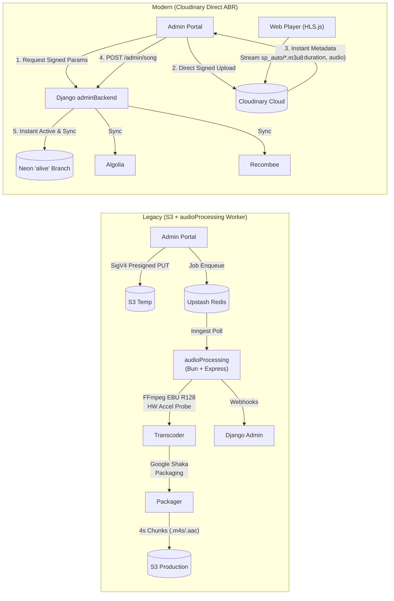

# 🚀 End-to-End Execution Plan: Cloudinary Migration & `audioProcessing` Decommissioning

> **Target Environment**:
> * **Git Branch**: `alive`
> * **Neon PostgreSQL Branch**: `alive` (`br-red-shadow-azr2g2iz` &bull; `ep-noisy-snow-az1s7xa9-pooler`)
> * **Database**: `one-melody-spring`

---

## 📌 1. Architecture Overview & Paradigm Shift

### Key Architectural Gains:
1. **Total Elimination of `audioProcessing` Worker**: Eliminates Bun, Express, Inngest, FFmpeg hardware probes (Apple VideoToolbox / NVENC / QSV), Google Shaka Packager binaries, and local scratch disk garbage collectors.
2. **Total Elimination of AWS S3**: No more multipart uploads, SigV4 pre-signed PUT URLs, CORS configuration headaches, or slow multi-page S3 prefix deletions.
3. **Instant Catalog Ingestion**: Upload directly from browser to Cloudinary $\to$ Cloudinary returns duration, format, and bitrate in the upload response $\to$ Song created directly as `ACTIVE` and synced to Algolia/Recombee in $<2$ seconds.
4. **Out-of-the-Box Adaptive Bitrate Streaming (ABR)**: Cloudinary dynamically produces multi-bitrate HLS (`master.m3u8`) and MPEG-DASH (`master.mpd`) manifests cached at global edge CDNs.
5. **Zero-Compute 9:16 Vertical Video Canvas**: URL transformation parameter (`so_${start},eo_${end},ar_9:16,c_fill,g_auto,vc_h264,ac_none`) generates vertical looping clips on demand without offline video encoding.
6. **Unified Atomic Deletions**: Single call to `cloudinary.uploader.destroy(public_id, resource_type="video")` cleans up audio/video assets atomically.

---

## 📐 2. Cloudinary Media Specification & URLs

Cloudinary manages audio within the `video` resource family (`resource_type: "video"`).

| Asset Type | Cloudinary URL Structure | Output Format | Purpose |
| :--- | :--- | :---: | :--- |
| **Audio HLS Master** | `https://res.cloudinary.com/${CLOUD_NAME}/video/upload/sp_auto/${songKey}.m3u8` | `.m3u8` | Adaptive audio stream for Web Player (HLS.js) & iOS |
| **Audio MPEG-DASH** | `https://res.cloudinary.com/${CLOUD_NAME}/video/upload/sp_auto/${songKey}.mpd` | `.mpd` | MPEG-DASH stream for Android / Shaka Player |
| **Full Video HLS** | `https://res.cloudinary.com/${CLOUD_NAME}/video/upload/sp_auto/${fullVideoKey}.m3u8` | `.m3u8` | Multi-bitrate music video (1080p, 720p, 480p, 360p) |
| **Full Video DASH** | `https://res.cloudinary.com/${CLOUD_NAME}/video/upload/sp_auto/${fullVideoKey}.mpd` | `.mpd` | MPEG-DASH music video |
| **Dynamic Canvas Loop** | `https://res.cloudinary.com/${CLOUD_NAME}/video/upload/so_${start},eo_${end},ar_9:16,c_fill,g_auto,vc_h264,ac_none/${fullVideoKey}.mp4` | `.mp4` | 30s muted vertical canvas loop |

---

## 🔄 3. Database & Environment Configuration

### Neon Database Branch 'alive'
The database configuration across all submodules has been linked to the `alive` branch:
* **Host Endpoint**: `ep-noisy-snow-az1s7xa9-pooler.c-3.ap-southeast-1.aws.neon.tech`
* **Database Name**: `one-melody-spring`
* **JDBC URL**: `jdbc:postgresql://ep-noisy-snow-az1s7xa9-pooler.c-3.ap-southeast-1.aws.neon.tech/one-melody-spring?sslmode=require&channelBinding=require`
* **Updated Files**:
  - `adminBackend/.env`
  - `coreEngine/.env`
  - `migration/.env`

---

## 🛠️ 4. Phased Implementation Roadmap

### Phase 1: `adminBackend` SDK & Service Layer Setup
1. **Dependency Upgrade**:
   - Update `adminBackend/pyproject.toml`: Remove `boto3`, add `cloudinary>=1.41.0`. Run `uv sync`.
2. **Environment Variables**:
   - Add `CLOUDINARY_CLOUD_NAME`, `CLOUDINARY_API_KEY`, `CLOUDINARY_API_SECRET` to `adminBackend/.env`.
3. **Cloudinary Service (`adminBackend/admin/core/services/cloudinary_service.py`)**:
   - `generate_upload_signature(folder="songs", resource_type="video")`: Generates HMAC-SHA signed params for browser direct upload.
   - `destroy_media(public_id, resource_type="video")`: Deletes media from Cloudinary.
   - `get_media_details(public_id)`: Fetches duration, codec, bitrate, channels.
4. **Deprecate `s3_service.py`**:
   - Replace S3 upload URL webhook (`/webhook/internal/song-upload-url` and `/webhook/internal/video-upload-url`) with Cloudinary signature endpoint.

---

### Phase 2: Ingestion & Direct Upload Pipeline
1. **Frontend Direct Upload (`adminFrontend/src/app/songs/components/CreateSongModal.tsx`)**:
   - Update `CreateSongModal.tsx` and `EditSongModal.tsx` to request upload signature from backend.
   - Upload file directly to `https://api.cloudinary.com/v1_1/${cloudName}/video/upload` via `uploadWithProgress` (XHR progress bar maintained!).
   - Cloudinary returns `public_id`, `duration`, `format`, `bytes`.
2. **Direct Song Registration (`adminBackend/admin/catalog/views.py`)**:
   - In `SongListView.post`, receive `songKey` (`public_id`), `duration`, `fullVideoKey`.
   - Create `Song` entity with status `ACTIVE`.
   - Directly call `AlgoliaService.save_song(song)`.
   - Directly call `RecombeeService.save_song(song)`.
   - Increment `PaginationMetadataService`.
   - Song is immediately playable without waiting for transcoding queues.

---

### Phase 3: Player & Consumer Streaming Updates (`audioFrontend`)
1. **Environment Configuration**:
   - Add `NEXT_PUBLIC_CLOUDINARY_CLOUD_NAME` to `audioFrontend/.env.local`.
2. **URL Generation in `audioFrontend/src/lib/player-utils.ts`**:
   - Update `mapToPlayerSong` and `normalizePlayerSong` to construct:
     - `streamUrl = https://res.cloudinary.com/${CLOUD_NAME}/video/upload/sp_auto/${songKey}.m3u8`
     - `fullVideoUrl = https://res.cloudinary.com/${CLOUD_NAME}/video/upload/sp_auto/${fullVideoKey}.m3u8`
     - `fullVideoDashUrl = https://res.cloudinary.com/${CLOUD_NAME}/video/upload/sp_auto/${fullVideoKey}.mpd`
     - `captionUrl` resolution.
3. **Dynamic Canvas Clip Generation**:
   - Update `getCanvasVideoUrl()` to use Cloudinary on-the-fly cropping:
     `https://res.cloudinary.com/${CLOUD_NAME}/video/upload/so_${start},eo_${end},ar_9:16,c_fill,g_auto,vc_h264,ac_none/${fullVideoKey}.mp4`

---

### Phase 4: Cascade Deletion & Jobs Dashboard
1. **Cascade Teardown in `adminBackend`**:
   - Update `WebhookDeleteS3View` $\to$ `WebhookDeleteCloudinaryView` (calls `CloudinaryService.destroy_media(song_key)`).
   - If `full_video_key` exists, destroy it as well.
   - Record `cloudinary_deleted_at` and `cloudinary_duration_ms` in `DeleteJob`.
2. **Admin Portal UI Updates**:
   - Update `adminFrontend/src/lib/api.ts`: Replace `S3_DELETED` stage with `CLOUDINARY_DELETED`.
   - Update `CascadeDeleteTable.tsx` and `JobMetricsCards.tsx` stage badges.

---

### Phase 5: Decommissioning `audioProcessing` & Cleanup
1. **Decommission `audioProcessing/` Service**:
   - Remove `audioProcessing` from active deployment scripts.
   - Update `docker-compose.yml`: Remove `inngest` worker service (mailEvents does not use Inngest).
2. **Environment & Dependency Cleanup**:
   - Remove AWS S3 credentials (`AWS_ACCESS_KEY_ID`, `AWS_SECRET_ACCESS_KEY`, `S3_TEMP_BUCKET`, `S3_PRODUCTION_BUCKET`) from all `.env` files.
   - Verify `coreEngine` remains completely decoupled (no AWS libraries in pom.xml).
3. **Database Migration**:
   - Flyway migration `V7__update_delete_jobs_for_cloudinary.sql` in `migration/` to rename/alias `s3_deleted_at` $\to$ `cloudinary_deleted_at`.

---

## 🧪 5. Testing & Verification Checklist

- [ ] **Database Connectivity**: Verify `coreEngine` and `adminBackend` connect to Neon branch `alive` without errors.
- [ ] **Cloudinary SDK Test**: Verify signature generation and API communication with Cloudinary.
- [ ] **Direct Upload Flow**: Upload a sample audio track (FLAC/MP3) via `CreateSongModal`, verify progress bar, and check Cloudinary response metadata.
- [ ] **Immediate Activation**: Check that song is inserted into Neon DB as `ACTIVE` and instantly searchable in Algolia.
- [ ] **Adaptive HLS Playback**: Load `audioFrontend` web player and verify seamless HLS playback via `sp_auto/*.m3u8` with HLS.js.
- [ ] **Dynamic Canvas Looper**: Verify vertical 9:16 looping canvas plays smoothly in the player backdrop.
- [ ] **Cascade Deletion**: Delete a song via admin portal, verify asset is purged from Algolia, Recombee, and Cloudinary, and the record is soft/hard deleted from PostgreSQL.
- [ ] **Core Test Suite**: Run all 121 automated tests in `coreEngine` (`./mvnw test`).
