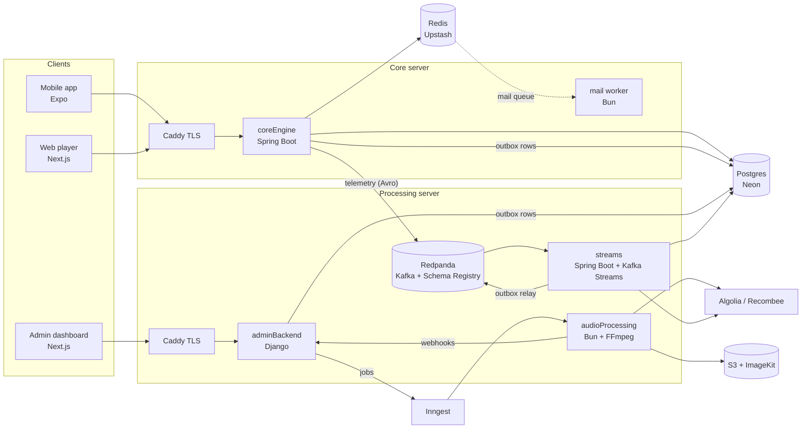

# One Melody

A music streaming platform: a mobile app (React Native / Expo), a web player and an
admin dashboard (Next.js), backed by a Spring Boot API, a Django admin API, a Bun media
pipeline and a Kafka (Redpanda) event pipeline.


## Features

- **Listening:** HLS streaming with gapless playback and crossfade, synced lyrics, canvas videos, a queue, resume across devices, and an offline-aware home screen.
- **Discovery:** Algolia search (including lyric lines), Recombee recommendations, mood radio based on audio features (tempo, energy, valence, danceability), and onboarding by favourite artists and genres.
- **Library:** favourites, user playlists with share links, followed artists, history, and a public `/song/<id>` share page with Open Graph tags.
- **Admin:** catalog management (songs, artists, playlists), upload and transcoding jobs with live progress, catalog health, user moderation, and role-gated actions.
- **Pipeline:** uploads are transcoded with FFmpeg (audio, video, canvas), analysed for audio features, and indexed into Algolia and Recombee through Inngest workflows.
- **Events:** telemetry and state changes flow through Kafka to stream services that keep stats, listening sessions, history and the search and recommendation indexes up to date.

## Architecture



| Service | Folder | Stack | Port | Runs on |
|---|---|---|---|---|
| Core API | `coreEngine/` | Spring Boot 4.1, Java 21, JPA, Redis | 9090 (prod) / 8080 (local) | core server |
| Mail worker | `workers/mailEvents/` | Bun, SMTP / SES / Resend | – | core server |
| Admin API | `adminBackend/` | Django 6, DRF, Python 3.12 | 8000 | processing server |
| Media pipeline | `audioProcessing/` | Bun, Express, Inngest, FFmpeg | 5010 | processing server |
| Stream services | `streams/` | Spring Boot, Kafka Streams | 8095 | processing server |
| Kafka | Redpanda (`infra/kafka/`) | Kafka API, Schema Registry, HTTP proxy | 9092 / 8081 / 8082 | processing server |
| Web player | `audioFrontend/` | Next.js 16, React 19 | 3000 | Vercel |
| Admin dashboard | `adminFrontend/` | Next.js 16, TanStack Query and Table | 3001 (local) | Vercel |
| Mobile app | `audioApp/` | Expo SDK 58, React Native | – | iOS / Android |
| Migrations | `migration/` | Flyway (V1–V17) | – | run by hand |

Shared data: Postgres on Neon (Flyway in `migration/` owns the schema; Django never
migrates), Redis on Upstash (caches, sessions, OTPs, rate limits, the mail queue), and media in
S3 behind ImageKit.

### Event pipeline

The core API sends telemetry (plays, skips, search, queue, feedback) to Kafka as Avro.
State changes (favourites, follows, playlist songs, sign-ups, catalog changes, OTP emails)
are written to an `outbox_events` table in the same transaction, then published by the
outbox relay. One `streams/` app runs five services as Spring profiles:

| Profile | Does |
|---|---|
| `outbox-relay` | Publishes outbox rows; woken by a Kafka signal, so it never polls Postgres |
| `stats` | Kafka Streams totals and daily windows → `song_stats`, `song_daily_stats`, `artist_stats` |
| `activity` | 30-minute listening sessions → `listening_sessions`; play history → `user_history` |
| `sync` | Batched Recombee interactions and Algolia updates |
| `notification` | Sends email through SMTP, SES or Resend, with retries and a dead-letter topic |

Schemas live in `communication/` and are checked for backward compatibility in CI. The
pipeline is off by default (`EVENTS_MODE=LEGACY`); see [`infra/kafka/README.md`](infra/kafka/README.md)
for the modes and the rollout steps.

## Repository layout

```
coreEngine/         Spring Boot core API (auth, catalog, playback, home, recommendations)
communication/      Avro event schemas + generated Java classes (shared by coreEngine and streams)
streams/            Outbox relay and Kafka Streams services
adminBackend/       Django admin API (catalog, jobs, users, webhooks from the pipeline)
audioProcessing/    Bun media pipeline: Inngest functions for transcoding, features, indexing, deletes
workers/mailEvents/ Bun mail worker (Redis queue → SMTP / SES / Resend)
audioFrontend/      Next.js web player
adminFrontend/      Next.js admin dashboard
audioApp/           Expo mobile app
migration/          Flyway migrations, the single source of truth for the schema
Docker/             Production compose files and deploy scripts (core/ and admin/ servers)
infra/              Terraform (VPC, EC2, S3, Secrets Manager), Kafka topics, observability
assets/             Architecture diagram
pom.xml             Root Maven build: communication, coreEngine, streams
```

## Local development

Prerequisites: Java 21, Bun 1.3+, Node 20+, Python 3.12 with [uv](https://docs.astral.sh/uv/),
Docker, and a Postgres database (a Neon branch or a local one).

Each service reads a gitignored `.env`. Copy the matching `.env.example` and fill it in;
never commit real `.env` files.

```bash
# Database schema (run first and after pulling new migrations)
cd migration && ../mvnw spring-boot:run

# Kafka + Schema Registry + topics (optional; only needed with EVENTS_MODE=DUAL or KAFKA)
docker compose up -d redpanda redpanda-init

# Inngest dev server (needed for uploads and transcoding)
docker compose up -d inngest
```

```bash
./mvnw -pl coreEngine -am spring-boot:run         # core API       http://localhost:8080
./mvnw -pl streams -am spring-boot:run            # stream services (MAIL_PROVIDER=log for local dev)
cd adminBackend/admin && uv run python manage.py runserver 0.0.0.0:8000
cd audioProcessing && bun install && bun run dev  # media pipeline http://localhost:5010
cd workers/mailEvents && bun install && bun run dev
cd audioFrontend && bun install && bun run dev    # web player     http://localhost:3000
cd adminFrontend && bun install && bun run dev -- -p 3001   # admin dashboard http://localhost:3001
cd audioApp && npm install && npx expo start      # mobile app
```

The Java modules build from the repo root, because `coreEngine` and `streams` depend on
`communication/`. Use the root `./mvnw` with `-pl <module> -am`.

## Tests

| Service | Command |
|---|---|
| Core API | `./mvnw -pl coreEngine -am test` (includes a Testcontainers Redpanda test) |
| Stream services | `./mvnw -pl streams -am test` (Kafka Streams topology tests, Postgres + Redpanda containers) |
| Event schemas | `./mvnw -pl communication test` (backward-compatibility check) |
| Admin API | `cd adminBackend/admin && uv run python manage.py test` |
| Media pipeline | `cd audioProcessing && bun test` |
| Mail worker | `cd workers/mailEvents && bun test` |
| Mobile app | `cd audioApp && npm test` |
| Admin dashboard | `cd adminFrontend && bun run test:e2e` (Playwright, mocked backend) |
| Web apps | `bunx tsc --noEmit && bun run build` in each Next.js app |

Tests that need Docker skip themselves when Docker isn't running.

## CI/CD and releases

`.github/workflows/work.yml` runs only the tests for services whose files changed. On a
push to `main` it builds and pushes `:latest` and `:sha-<commit>` images to Docker Hub.

Production runs the `:stable` tag. To ship, run **Actions → Promote to Production**, which
re-points `:stable` (and keeps `:stable-previous` for rollback). Watchtower on each server
picks it up within about 30 seconds. Details: [`Docker/RELEASES.md`](Docker/RELEASES.md).

Database migrations are not automatic. Apply new Flyway versions with the migration app
before promoting an image that needs them.

## Infrastructure and secrets

- [`infra/README.md`](infra/README.md): Terraform for the VPC, the two EC2 instances, S3 and the Kafka volume.
- [`infra/SECRETS.md`](infra/SECRETS.md): AWS Secrets Manager names, which service reads what, one-time setup and key rotation.
- [`infra/kafka/README.md`](infra/kafka/README.md): event pipeline modes, rollout and rollback.
- `infra/observability/`: OpenTelemetry collector configs and alert definitions.
- `Docker/core/deploy.sh` and `Docker/admin/deploy.sh`: deploy the compose stack to each server.

## License

MIT. Built by [Karan Kumar](https://github.com/karankumar786786).
