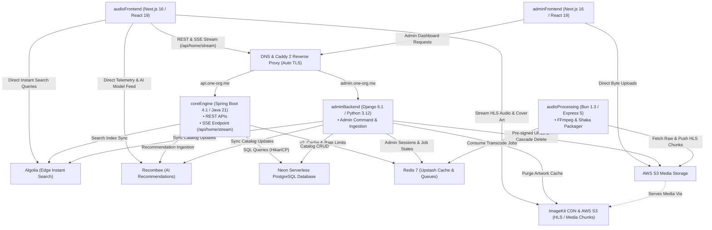
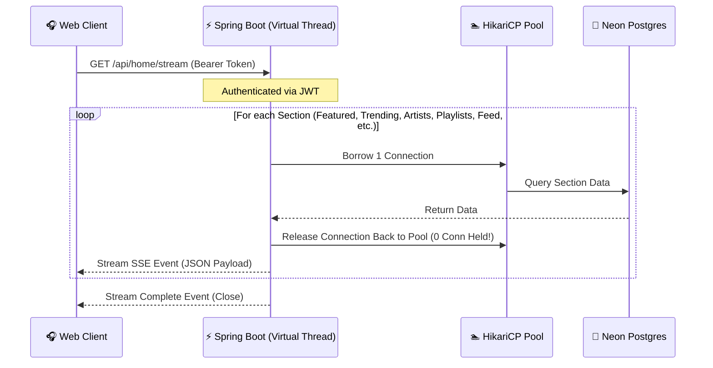
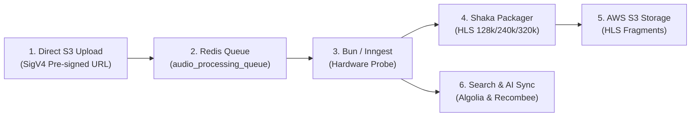
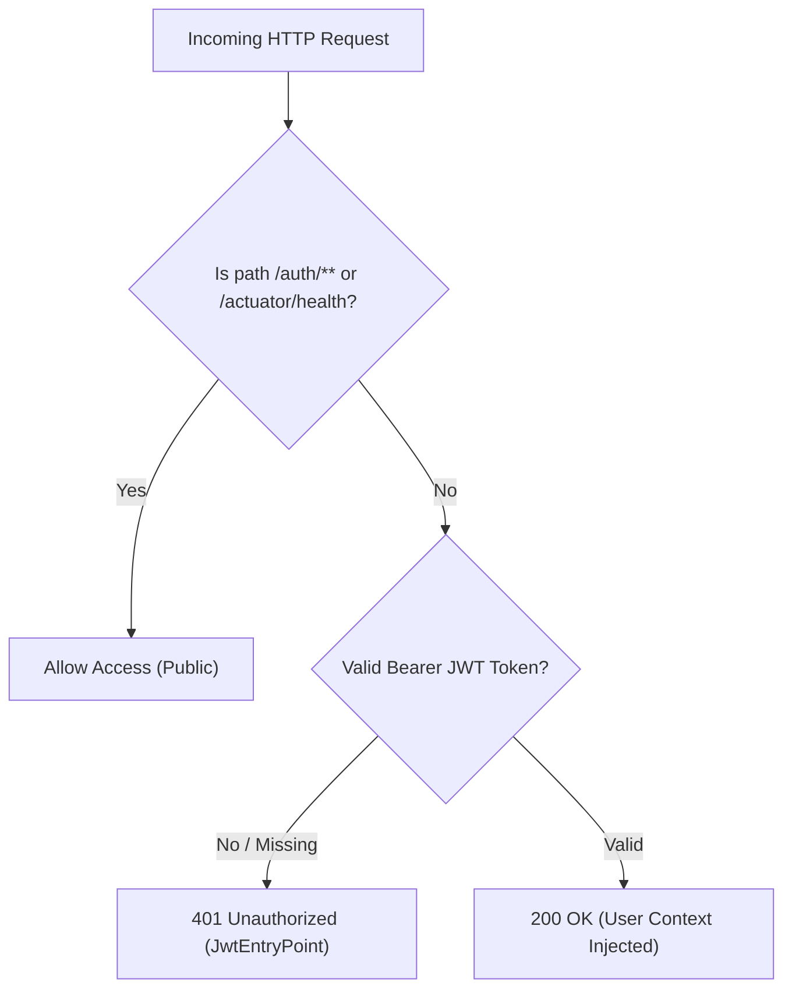

# 🎵 One Melody — Cloud-Native Enterprise Audio & Video Streaming Platform (157 APIs)

[](https://github.com/karankumar786786/AudioMelodySpringboot)
[](https://openjdk.org/projects/jdk/21/)
[](https://spring.io/projects/spring-boot)
[](https://www.python.org/)
[](https://www.djangoproject.com/)
[](https://github.com/astral-sh/uv)
[](https://nextjs.org/)
[](https://react.dev/)
[](https://tailwindcss.com/)
[](https://www.typescriptlang.org/)
[](https://bun.sh/)
[](https://expressjs.com/)
[](https://caddyserver.com/)
[](https://aws.amazon.com/s3/)
[](https://www.algolia.com/)
[](https://www.recombee.com/)
[](https://imagekit.io/)
[](https://www.inngest.com/)
[-DC382D.svg?style=flat&logo=redis)](https://redis.io/)
[](https://www.postgresql.org/)
[-success.svg?style=flat)](https://github.com/karankumar786786/AudioMelodySpringboot)

**One Melody** is an enterprise-grade, distributed multimedia streaming platform engineered for high concurrency, low-latency adaptive playback, and automated cloud operations. Built with modern microservice design principles, it couples high-performance **Java 21 / Spring Boot 4.1** streaming gateways (`api.one-org.me`) with a dedicated **Python 3.12 / Django 6.1** administrative command microservice (`admin.one-org.me`), **Node.js / Bun / Inngest** asynchronous media processing workers (`process.one-org.me`), **Google Shaka Packager** multi-bitrate HLS/DASH chunking, and dual **Next.js 16** frontends (`adm.one-org.me` and consumer apps) delivering a pitch-black OLED monochrome aesthetic.

---

## 🏛️ System Architecture



---

## 🔄 Recent Changes & Engineering Upgrades

We recently completed a major architectural overhaul across the entire platform to optimize database resource utilization, eliminate latency bottlenecks, enhance security, and resolve legacy cache issues:

### 1. Progressive SSE Streaming with Zero DB Connection Hoarding
- **Problem**: When loading the home page, the client previously dispatched 7–10 simultaneous REST queries, flooding the backend and exhausting the database connection pool.
- **Solution**: Replaced multi-request polling with a single progressive SSE stream (`GET /api/home/stream`) powered by Java 21 Virtual Threads.
- **Fetch ➔ Release ➔ Emit Cycle**: Each section query borrows a database connection from HikariCP, executes the query, and **immediately returns the connection to the pool** before transmitting the event across the network socket.
- **Impact**: Zero database connections are held during network streaming. Maximum 1 connection is utilized during active query execution. Client disconnects (`AtomicBoolean isClosed`) instantly halt remaining queries.

### 2. Neon Scale-to-Zero HikariCP Tuning
- **Problem**: Serverless Neon PostgreSQL charges per active compute second. Probes and unmanaged connections prevented instances from sleeping.
- **Solution**: Explicitly configured HikariCP (`maximum-pool-size: 20`, `minimum-idle: 2`, `idle-timeout: 60s`, `max-lifetime: 240s`, `leak-detection-threshold: 30s`).
- **Connection Leak Protection**: Set `open-in-view: false` across Spring JPA and added `DataSourceConfig` to log pool metrics and Hikari configuration on startup.

### 3. Elimination of Table Scan `count(*)` Queries ($\mathcal{O}(1)$ Pagination)
- **Problem**: `SongsApiService`, `ArtistApiService`, and `PlaylistApiService` previously fell back to `repository.count()`, causing full sequential table/index scans on growing catalogs.
- **Solution**: Removed all fallback `count(*)` queries. Catalog metadata is now resolved in $\mathcal{O}(1)$ time directly from the indexed `pagination_meta_data` table and Redis cache via `PaginationMetaDataService`.
- **Impact**: Pagination latency dropped from ~150ms to **under 2ms**.

### 4. Redis Cache Versioning (`v2:`) & Jackson Polymorphic Serializer
- **Problem**: Redis previously logged `JsonToken.START_ARRAY` deserialization warnings due to legacy un-typed array keys conflicting with polymorphic type wrappers.
- **Solution**: In `RedisConfig`, isolated the cache namespace using a `v2:` key prefix (`v2:featured_songs`, `v2:trending_songs`, etc.) and configured `GenericJacksonJsonRedisSerializer.builder()` with `@class` type support.
- **Self-Healing**: Added an automated eviction error handler that deletes corrupted or malformed keys on access without breaking the application.

### 5. Strict Security Lockdown (100% Authentication on All `/api/**` Endpoints)
- **Problem**: Search (`/api/search`) and home endpoints were previously publicly accessible without tokens.
- **Solution**: Removed `permitAll()` on all internal API endpoints in `SecurityConfig`. Only `/auth/**` (login, register, verify-otp, refresh) and `/actuator/health` remain public.
- **Enforcement**: Any unauthenticated or forged request to `/api/**` immediately returns `HTTP 401 Unauthorized` with a standardized JSON error response.

### 6. Frontend Query Optimization (RightInfoPanel)
- **Problem**: The right-side player drawer was fetching 50 songs (`musicApi.songs.getFeed(1, 50)`) on every track change even when recommendations were already populated.
- **Solution**: Added conditional fetching logic in `RightInfoPanel.tsx`—the heavy feed query is skipped if `similarSongs.length >= 3`.

### 7. Git & Repository Hygiene
- Purged all IDE configuration folders (`.vscode/`, `.idea/`) and OS artifacts (`.DS_Store`) from Git tracking across all submodules.
- Updated `.gitignore` rules to keep the repository lightweight and clean.

---

## ⚡ Core Flows

### 1. Progressive Server-Sent Events (SSE) Hydration Flow



### 2. Media Ingestion & Processing Pipeline



### 3. Dual-Layer Security & Authentication Flow



---

## 📑 Complete API Reference (157 Endpoints Total)

### 🎧 1. Consumer Streaming Gateway — 69 APIs (`coreEngine` &bull; Spring Boot 4.1 / Java 21)
> **Base Domain**: `https://api.one-org.me` (Port `9090`) &bull; Strict JWT Bearer Token Authentication on all `/api/**` routes.

#### 🔐 Authentication & Session Lifecycle
| Method | Endpoint | Auth | Description |
| :--- | :--- | :---: | :--- |
| `POST` | `/auth/register` | Public | Submits registration; dispatches 6-digit OTP and returns temporary token (`X-TEMP-TOKEN`). |
| `POST` | `/auth/verify-otp` | Public | Validates 6-digit OTP; returns `accessToken` & `refreshToken` and binds `X-Device-Id`. |
| `POST` | `/auth/resend-otp` | Public | Dispatches a fresh OTP for an active login or registration attempt. |
| `POST` | `/auth/login` | Public | Verifies credentials; sends OTP and returns temporary JWT. |
| `POST` | `/auth/refresh-token` | Public | Rotates access token using a valid `refreshToken` and device identifier (`X-Device-Id`). |
| `POST` | `/auth/logout` | Optional | Revokes current session and device binding from database and Redis. |
| `GET` | `/api/user/sessions` | **Bearer** | Lists all active multi-device sessions for the authenticated user. |
| `DELETE` | `/api/user/sessions/{sessionId}` | **Bearer** | Terminates a specific device session by ID. |
| `POST` | `/api/user/sessions/revoke-others` | **Bearer** | Revokes all active sessions except the currently active device. |

#### 👤 User Profile
| Method | Endpoint | Auth | Description |
| :--- | :--- | :---: | :--- |
| `GET` | `/api/user/profile` | **Bearer** | Retrieves profile details (ID, email, username, role, timestamps). |
| `PUT` | `/api/user/profile` | **Bearer** | Updates username and user profile attributes. |

#### ⚡ Progressive Home Hydration (Server-Sent Events)
| Method | Endpoint | Auth | Description |
| :--- | :--- | :---: | :--- |
| `GET` | `/api/home/stream` | **Bearer** | **Progressive SSE Stream**: Sequentially streams all 7 home sections on Java 21 Virtual Threads using the **Fetch $\to$ Release $\to$ Emit** cycle (0 DB connections held during network transmission). |

#### 🎵 Song Catalog & Albums
| Method | Endpoint | Auth | Description |
| :--- | :--- | :---: | :--- |
| `GET` | `/api/songs` | **Bearer** | Paginated catalog feed with $\mathcal{O}(1)$ pagination metadata (`page`, `size`). |
| `GET` | `/api/songs/trending` | **Bearer** | Retrieves top trending songs limited by `limit` (default: 10). |
| `GET` | `/api/songs/featured` | **Bearer** | Retrieves curated featured tracks from Redis cache / PostgreSQL. |
| `GET` | `/api/songs/{id}` | **Bearer** | Detailed song metadata, HLS master URL, canvas video keys, and duration (`max-age=30m`). |
| `GET` | `/api/songs/album/{albumName}` | **Bearer** | Retrieves all tracks belonging to a given album (supports `/songs`, `/fallback-songs`, `/backup-songs`). |
| `GET` | `/api/songs/albums` | **Bearer** | Retrieves all album cards with artwork and track counts (`max-age=15m`). |

#### 🎤 Artists & Onboarding
| Method | Endpoint | Auth | Description |
| :--- | :--- | :---: | :--- |
| `GET` | `/api/artists` | **Bearer** | Paginated artist catalog with follower counts and $\mathcal{O}(1)$ metadata. |
| `GET` | `/api/artists/{id}` | **Bearer** | Artist profile, biography, monthly listeners, and CDN avatar. |
| `GET` | `/api/artists/{id}/songs` | **Bearer** | Paginated discography for an artist with fallback routing. |
| `POST` | `/api/artists/{id}/follow` | **Bearer** | Follow an artist and increment follower counters. |
| `POST` | `/api/artists/{id}/unfollow` | **Bearer** | Unfollow an artist and decrement follower counters. |
| `DELETE`| `/api/artists/{id}/follow` | **Bearer** | Idempotent alias to unfollow an artist. |
| `GET` | `/api/artists/{id}/follow-status` | **Bearer** | Checks if the authenticated user follows this artist. |
| `GET` | `/api/artists/onboarding-list` | **Bearer** | Returns popular artist cards for initial user preference onboarding. |
| `GET` | `/api/artists/search` | **Bearer** | Direct substring search across artists (`?q=`). |
| `POST` | `/api/artists/onboarding` | **Bearer** | Saves selected onboarding artists and seeds the initial recommendation vector. |

#### 📂 Curated Playlists
| Method | Endpoint | Auth | Description |
| :--- | :--- | :---: | :--- |
| `GET` | `/api/playlists` | **Bearer** | Paginated list of public editorial playlists with $\mathcal{O}(1)$ metadata. |
| `GET` | `/api/playlists/{id}` | **Bearer** | Curated playlist details, cover art, and total song counts. |
| `GET` | `/api/playlists/{id}/songs` | **Bearer** | Paginated song tracks included in this curated playlist. |

#### 🎧 Personal & Shared User Playlists
| Method | Endpoint | Auth | Description |
| :--- | :--- | :---: | :--- |
| `GET` | `/api/user/playlists` | **Bearer** | Paginated personal playlists owned or saved by the user. |
| `POST` | `/api/user/playlists` | **Bearer** | Creates a new user playlist (`name`, `privacy`). |
| `GET` | `/api/user/playlists/{id}` | **Bearer** | Fetches user playlist metadata by ID. |
| `PUT` | `/api/user/playlists/{id}` | **Bearer** | Renames a personal playlist. |
| `PATCH`| `/api/user/playlists/{id}/privacy`| **Bearer** | Toggles playlist privacy (`PUBLIC`, `PRIVATE`). |
| `DELETE`| `/api/user/playlists/{id}` | **Bearer** | Deletes a user-owned playlist. |
| `GET` | `/api/user/playlists/{id}/songs` | **Bearer** | Paginated list of tracks within the personal playlist. |
| `POST` | `/api/user/playlists/{id}/songs` | **Bearer** | Adds a song to the user playlist. |
| `DELETE`| `/api/user/playlists/{id}/songs/{songId}` | **Bearer** | Removes a song from the user playlist. |
| `POST` | `/api/user/playlists/{id}/save` | **Bearer** | Saves/bookmarks another user's public playlist to library. |
| `DELETE`| `/api/user/playlists/{id}/save` | **Bearer** | Removes saved playlist from user library. |
| `GET` | `/api/user/playlists/{id}/saved` | **Bearer** | Returns boolean flag `{ "isSaved": true/false }`. |
| `POST` | `/api/user/playlists/{id}/duplicate` | **Bearer** | Duplicates a playlist into a new owned copy. |
| `GET` | `/api/user/playlists/shared/{tokenOrId}` | **Bearer** | Resolves a playlist share token or public ID. |
| `GET` | `/api/user/playlists/shared/{tokenOrId}/songs` | **Bearer** | Fetches tracks from a shared playlist link. |

#### 🕒 User History & Search History
| Method | Endpoint | Auth | Description |
| :--- | :--- | :---: | :--- |
| `GET` | `/api/user/history` | **Bearer** | Paginated chronological listening history. |
| `GET` | `/api/user/history/recent` | **Bearer** | Quick list of recently played unique tracks. |
| `GET` | `/api/user/history/search` | **Bearer** | Grouped search history keywords and clicked entities. |
| `POST` | `/api/user/history/search` | **Bearer** | Logs a search term and result selection. |
| `DELETE`| `/api/user/history/search/{id}`| **Bearer** | Removes a single search history entry. |
| `DELETE`| `/api/user/history/search` | **Bearer** | Clears the user's entire search query history. |

#### 📊 Interactions, Favourites & Analytics
| Method | Endpoint | Auth | Description |
| :--- | :--- | :---: | :--- |
| `POST` | `/api/interaction/play` | **Bearer** | Logs track play with completion percentage (`percentage`). Updates listen metrics and Recombee. |
| `POST` | `/api/interaction/skip` | **Bearer** | Logs skip event for recommendation penalty calculation. |
| `POST` | `/api/interaction/search-play`| **Bearer** | Records song playback initiated from search results. |
| `POST` | `/api/interaction/search-click`| **Bearer** | Records search result item click (`type`, `id`). |
| `POST` | `/api/interaction/queue-add` | **Bearer** | Tracks user intent when adding track to queue. |
| `POST` | `/api/interaction/queue-remove` | **Bearer** | Tracks track removal from player queue. |
| `POST` | `/api/interaction/dislike` | **Bearer** | Registers negative preference signal. |
| `POST` | `/api/interaction/share` | **Bearer** | Registers viral / share event signal. |
| `POST` | `/api/interaction/favourite/{songId}` | **Bearer** | Adds song to user's "Liked Songs" library. |
| `DELETE`| `/api/interaction/favourite/{songId}` | **Bearer** | Removes song from "Liked Songs" library. |
| `GET` | `/api/interaction/favourites` | **Bearer** | Paginated list of liked tracks with $\mathcal{O}(1)$ metadata. |

#### 🔍 Search & AI Recommendations
| Method | Endpoint | Auth | Description |
| :--- | :--- | :---: | :--- |
| `GET` | `/api/search/config` | **Bearer** | Retrieves public Algolia API credentials and index names (`max-age=1h`). |
| `GET` | `/api/search` | **Bearer** | Multi-index search across songs, artists, and playlists. |
| `GET` | `/api/recommendations/user` | **Bearer** | Collaborative personalized song recommendations for user (`?count=10`). |
| `GET` | `/api/recommendations/similar/{songId}` | **Bearer** | Content-based and item-to-item similar songs. |
| `GET` | `/api/recommendations/radio` | **Bearer** | Infinite radio feed seeded by a track (`?seedSongId=...&excludeIds=...`). |

#### 🩺 Actuator Health Probes
| Method | Endpoint | Auth | Description |
| :--- | :--- | :---: | :--- |
| `GET` | `/actuator/health` | Public | Spring Boot Actuator liveness/readiness probe used by Docker, Kubernetes, and Caddy. |

---

### 🛡️ 2. Administrative Command APIs — 88 APIs (`adminBackend` &bull; Django 6.1 / Python 3.12)
> **Base Domain**: `https://admin.one-org.me` (Port `8000`) &bull; Stateful Redis Session Tracking via HTTP-only cookies (`admin_session`, `access_token`).

#### 🔐 Admin Authentication & Session Management
| Method | Endpoint | Auth | Description |
| :--- | :--- | :---: | :--- |
| `POST` | `/auth/login` or `/admin/auth/login` | Public | Submits admin credentials; dispatches cryptographic OTP email. |
| `POST` | `/auth/verify-otp` or `/admin/auth/verify-otp`| Public | Verifies 6-digit OTP with 5-attempt lockout; issues stateful Redis session. |
| `POST` | `/auth/resend-otp` or `/admin/auth/resend-otp`| Public | Generates a fresh OTP for the pending admin session. |
| `POST` | `/auth/refresh-token` or `/admin/auth/refresh-token` | Public | Refreshes admin session credentials. |
| `POST` | `/auth/register` or `/admin/auth/register` | Public | Registers a new staff account (requires superuser approval). |
| `POST` | `/auth/logout` | Session | Logs out current admin and terminates the Redis session. |
| `GET` | `/admin/auth/profile` or `/admin/auth/me` | Session | Returns current administrator role, permissions, and email. |
| `GET` | `/admin/auth/sessions` | Session | Lists active login sessions across all administrator accounts. |
| `DELETE`| `/admin/auth/sessions/{sessionId}` | Session | Revokes a specific admin session. |
| `POST` | `/admin/auth/sessions/revoke-all` | Session | **Fleet Revocation**: Immediately terminates all active admin sessions across the entire fleet. |

#### 👥 User Account Governance & Moderation
| Method | Endpoint | Auth | Description |
| :--- | :--- | :---: | :--- |
| `GET` | `/admin/account` | Session | Paginated list of all registered platform users with search and role filters. |
| `POST` | `/admin/account/{email}` | Session | Updates user role (e.g., Promote to Admin / Staff). |
| `POST` | `/admin/account/{email}/block` | Session | Blocks a user account, disabling login and API tokens. |
| `POST` | `/admin/account/{email}/unblock` | Session | Restores a blocked user account to active status. |
| `POST` | `/admin/account/{email}/demote` | Session | Demotes an administrator back to consumer permissions. |
| `DELETE`| `/admin/account/{email}/delete` | Session | Soft-deletes user account and queues data cleanup. |
| `GET` | `/admin/account/{email}/sessions` | Session | Lists active multi-device sessions of a specific user. |
| `DELETE`| `/admin/account/{email}/sessions/{sessionId}` | Session | Forces disconnection of a user's device session. |
| `POST` | `/admin/account/{email}/sessions/revoke-all` | Session | Revokes all active sessions for that user. |

#### 🎵 Catalog Management — Songs & Ingestion
| Method | Endpoint | Auth | Description |
| :--- | :--- | :---: | :--- |
| `GET` | `/admin/song` | Session | Paginated master catalog of all songs with status filters (`ACTIVE`, `DELETED`, etc.). |
| `POST` | `/admin/song` | Session | **Initiate Media Ingestion**: Creates a new song ingestion job, records metadata, and queues for transcode. |
| `GET` | `/admin/song/{id}` | Session | Retrieves complete song record, metadata, and CDN keys. |
| `PUT` | `/admin/song/{id}` | Session | Updates song title, artist, genre, lyrics ID, feature flag, or artwork key. Syncs changes to Algolia & Recombee. |
| `DELETE`| `/admin/song/{id}` | Session | **5-Stage Cascade Teardown**: Soft-deletes song and initiates background purge of Algolia $\to$ Recombee $\to$ ImageKit CDN $\to$ S3 HLS directory $\to$ DB commit. |
| `PATCH`/`POST`| `/admin/song/{id}/featured` | Session | Toggles whether a track is highlighted in the home featured section. |
| `POST` | `/admin/song/{id}/reprocess-audio` | Session | Re-dispatches song audio to the Bun/Inngest transcoding queue. |
| `POST` | `/admin/song/{id}/reprocess-video` | Session | Re-dispatches video canvas clip to processing queue. |
| `POST` | `/admin/song/{id}/recover-media` | Session | Recovers lost/broken S3 media files from cold storage. |
| `POST` | `/admin/song/reindex-recombee` | Session | Batch re-indexes all active songs into Recombee recommendation catalog. |
| `GET` | `/admin/song/jobs` | Session | Lists all ingestion jobs associated with songs. |
| `GET` | `/admin/song/job/{id}` | Session | Detailed status of a song's specific packaging job. |

#### 🎤 Catalog Management — Artists
| Method | Endpoint | Auth | Description |
| :--- | :--- | :---: | :--- |
| `GET` | `/admin/artist` | Session | Paginated list of all artists with search and status filtering. |
| `POST` | `/admin/artist` | Session | Creates a new verified artist profile with cover art key and biography. |
| `GET` | `/admin/artist/{id}` | Session | Retrieves detailed artist profile information. |
| `PUT` | `/admin/artist/{id}` | Session | Updates artist name, bio, birth date, or artwork (purging old CDN keys). |
| `DELETE`| `/admin/artist/{id}` | Session | Cascades artist deletion, marking discography as deleted and queuing cleanup. |
| `GET` | `/admin/artist/{id}/songs` | Session | Lists all songs linked to this artist. |

#### 📂 Catalog Management — Playlists
| Method | Endpoint | Auth | Description |
| :--- | :--- | :---: | :--- |
| `GET` | `/admin/playlist` | Session | Paginated curated playlists with track count and status. |
| `POST` | `/admin/playlist` | Session | Creates a new editorial curated playlist. |
| `GET` | `/admin/playlist/{id}` | Session | Fetches curated playlist details. |
| `PUT` | `/admin/playlist/{id}` | Session | Updates curated playlist name, description, and cover image. |
| `DELETE`| `/admin/playlist/{id}` | Session | Soft-deletes playlist and cascades joint entries. |
| `GET` | `/admin/playlist/{id}/songs` | Session | Lists all tracks assigned to this curated playlist. |
| `POST` | `/admin/playlist/{id}/songs/add` | Session | Adds a song to the curated playlist. |
| `DELETE`| `/admin/playlist/{id}/songs/{songId}` | Session | Removes a song from the curated playlist. |

#### ⚙️ Ingestion & Transcoding Jobs Monitor
| Method | Endpoint | Auth | Description |
| :--- | :--- | :---: | :--- |
| `GET` | `/admin/jobs` | Session | Paginated ingestion jobs list with filter parameters (`?status=...`). |
| `GET` | `/admin/jobs/active` | Session | Real-time monitoring of actively running transcoding tasks. |
| `GET` | `/admin/jobs/summary` | Session | Aggregate job statistics (counts of PENDING, PROCESSING, COMPLETED, FAILED). |
| `GET` | `/admin/jobs/queues` | Session | Inspects pending Redis queue depths (`audio_processing_queue`). |
| `GET` | `/admin/jobs/pending` | Session | Filtered shortcut for pending jobs. |
| `GET` | `/admin/jobs/processing` | Session | Filtered shortcut for currently transcoding jobs. |
| `GET` | `/admin/jobs/completed` | Session | Filtered shortcut for successful jobs. |
| `GET` | `/admin/jobs/status/{filterStatus}` | Session | Filter jobs by status enum. |
| `GET` | `/admin/jobs/{id}` | Session | Complete stage-by-stage Gantt timeline and error log for a job. |
| `POST` | `/admin/jobs/{id}/retry` | Session | **1-Click Retry**: Resets failed job state and re-enqueues into Redis. |
| `POST` | `/admin/jobs/{id}/recover-media`| Session | Re-probes S3 fragments and repairs corrupted manifest. |
| `DELETE`| `/admin/jobs/{id}` | Session | Deletes a job record. |
| `DELETE`| `/admin/jobs/failed` | Session | Clears all failed job logs. |
| `POST` | `/admin/jobs/sync-metadata` | Session | Re-computes and syncs row counters into `pagination_meta_data`. |

#### 🗑️ Cascade Deletion Jobs Monitor
| Method | Endpoint | Auth | Description |
| :--- | :--- | :---: | :--- |
| `GET` | `/admin/delete-jobs` | Session | Paginated audit log of multi-cloud cascade teardown jobs. |
| `GET` | `/admin/delete-jobs/active` | Session | Currently executing cascade teardowns. |
| `GET` | `/admin/delete-jobs/summary` | Session | Metrics on teardown stage progress and failure rates. |
| `GET` | `/admin/delete-jobs/pending` | Session | Teardown jobs waiting for cloud worker execution. |
| `GET` | `/admin/delete-jobs/in-progress` | Session | Teardowns actively removing S3/CDN assets. |
| `GET` | `/admin/delete-jobs/failed` | Session | Failed teardown attempts flagged for manual review. |
| `GET` | `/admin/delete-jobs/completed` | Session | Successfully purged entities. |
| `GET` | `/admin/delete-jobs/{id}` | Session | Detailed inspection of single teardown job audit trace. |
| `POST` | `/admin/delete-jobs/{id}/retry` | Session | Re-triggers failed teardown stage. |

#### 🔗 Internal Webhooks & Media Pipeline Handlers
| Method | Endpoint | Auth | Description |
| :--- | :--- | :---: | :--- |
| `POST` | `/webhook/internal/song-upload-url` | Internal | Generates SigV4 pre-signed AWS S3 PUT URL for direct raw audio upload. |
| `POST` | `/webhook/internal/video-upload-url`| Internal | Generates SigV4 pre-signed AWS S3 PUT URL for raw video clip upload. |
| `POST` | `/webhook/internal/image-upload-param`| Internal | Generates pre-signed authentication parameters for ImageKit CDN direct upload. |
| `POST` | `/webhook/internal/video-upload-param`| Internal | Generates ImageKit CDN upload parameters for short video canvas. |
| `POST` | `/webhook/job/{jobId}/transcoding-started` | Internal | Bun/Inngest callback indicating FFmpeg transcoding has commenced. |
| `POST` | `/webhook/job/{jobId}/transcoded` | Internal | Worker callback reporting Shaka Packager multi-bitrate HLS packaging success. |
| `POST` | `/webhook/job/{jobId}/save-search` | Internal | Worker callback reporting successful indexing in Algolia. |
| `POST` | `/webhook/job/{jobId}/save-recommendation`| Internal | Worker callback reporting successful item insertion in Recombee. |
| `POST` | `/webhook/job/{jobId}/finalize` | Internal | Finalizes job, activates song record in PostgreSQL, and updates pagination metadata. |
| `POST` | `/webhook/job/{jobId}/failed` | Internal | Worker callback reporting error and marking job as `FAILED`. |
| `GET` | `/webhook/job/{jobId}` | Internal | Worker status probe for job metadata. |
| `POST` | `/webhook/delete/{entityType}/{entityId}/delete-search` | Internal | Teardown stage 1: Purges entity from Algolia. |
| `POST` | `/webhook/delete/{entityType}/{entityId}/delete-recommendation`| Internal | Teardown stage 2: Purges entity from Recombee. |
| `POST` | `/webhook/delete/{entityType}/{entityId}/delete-imagekit` | Internal | Teardown stage 3: Purges artwork/video from ImageKit CDN. |
| `POST` | `/webhook/delete/{entityType}/{entityId}/delete-s3` | Internal | Teardown stage 4: Deletes HLS directory from AWS S3 bucket. |
| `POST` | `/webhook/delete/{entityType}/{entityId}/hard-delete` | Internal | Teardown stage 5: Performs permanent PostgreSQL record deletion. |
| `POST` | `/webhook/delete/{entityType}/{entityId}/failed` | Internal | Flags cascade teardown failure in `delete_jobs` table. |

#### 📊 Dashboard Analytics & Search
| Method | Endpoint | Auth | Description |
| :--- | :--- | :---: | :--- |
| `GET` | `/admin/dashboard/stats` | Session | Aggregated platform metrics (Total songs, total users, active streams, active jobs). |
| `GET` | `/admin/search` or `/api/search` | Session | Global administrative search across songs, artists, playlists, and user accounts. |
| `GET` | `/health` or `/api/health` | Public | Container health check probe for Gunicorn and Caddy. |

---

## 📁 Repository Structure

```
AudioMelodySpringboot/
├── coreEngine/                   # Spring Boot 4.1 / Java 21 Audio Streaming Gateway
│   ├── src/main/java/            # Controllers, Services, Repositories, Security & Caching
│   │   ├── Configuration/        # DataSourceConfig (HikariCP), RedisConfig (v2: builder)
│   │   ├── Controllers/Api/      # HomeApiController (SSE Stream), SongsApiController
│   │   ├── Security/             # SecurityConfig (Strict JWT), UserContextInterceptor
│   │   └── Services/Api/         # SongsApiService, ArtistApiService (O(1) Pagination)
│   └── src/test/java/            # 121 Automated Unit & Integration Tests (100% Pass)
├── adminBackend/                 # Django 6.1 / Python 3.12 Admin Command Center
│   ├── admin/api/                # Views, Serializers, Stateful Session Auth, Ingestion Audits
│   └── core/services/            # S3, Algolia, Recombee, ImageKit Cascade Teardown Services
├── audioFrontend/                # Next.js 16 / React 19 / Tailwind 4 Consumer Web Application
│   ├── src/app/home/             # Progressive SSE Stream Page with TanStack Query Fallback
│   ├── src/components/player/    # HLS.js Dual Buffer Player, Web Audio DSP, Lyrics Sync
│   └── src/lib/api/              # SSE Stream Client, Direct Algolia Search, Music APIs
├── adminFrontend/                # Next.js 16 / React 19 / Tailwind 4 Admin Portal
│   └── src/components/           # Real-Time Byte XHR Uploader, Job Gantt Monitors
├── audioProcessing/              # Bun 1.3 / Express 5 / Inngest Media Packaging Worker
│   ├── lib/transcode/            # hwaccel.ts (Hardware Encoder Probe), Shaka Packager
│   └── inngest/                  # Durable Step Workflows & Stage Recovery
├── workers/mailEvents/           # Bun 1.3 / Nodemailer Transactional Mail Worker
└── migration/                    # Spring Boot 4.1 / Flyway Database Migration Service
```

---

## 🚀 Quickstart & Local Setup

### Prerequisites
- **Java 21 (JDK)** &bull; **Maven 3.9+**
- **Python 3.12+** &bull; **uv package manager**
- **Node.js 20+** &bull; **Bun 1.3+**
- **Docker & Docker Compose** (Optional for containerized run)

### 1. Start the Core Engine (Spring Boot)
```bash
cd coreEngine
./mvnw clean spring-boot:run
# Gateway starts on http://localhost:9090
```

### 2. Start the Admin Backend (Django)
```bash
cd adminBackend
uv sync
uv run python manage.py migrate
uv run python manage.py runserver 0.0.0.0:8000
# Admin API starts on http://localhost:8000
```

### 3. Start the Media Processing Worker (Bun)
```bash
cd audioProcessing
bun install
bun run dev
# Worker starts on http://localhost:5010
```

### 4. Start the Consumer Frontend (Next.js)
```bash
cd audioFrontend
npm install
npm run dev
# App starts on http://localhost:3000
```

---

## 🧪 Automated Testing & Verification

The core engine includes **121 automated unit, integration, and security tests** covering all REST controllers, services, security filters, and telemetry pipelines:

```bash
cd coreEngine
./mvnw test
```

```text
[INFO] Results:
[INFO] 
[INFO] Tests run: 121, Failures: 0, Errors: 0, Skipped: 0
[INFO] 
[INFO] ------------------------------------------------------------------------
[INFO] BUILD SUCCESS
[INFO] Total time: 52.061 s
[INFO] ------------------------------------------------------------------------
```

---

## 📜 License & Acknowledgments
Built with ❤️ by [Karan Kumar](https://github.com/karankumar786786). Distributed under the MIT License.
