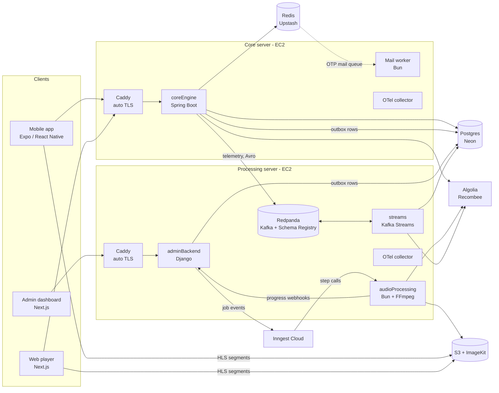
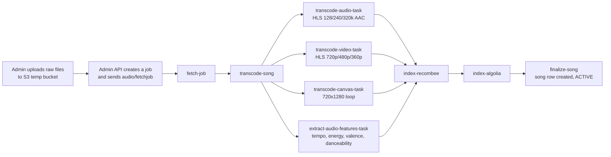
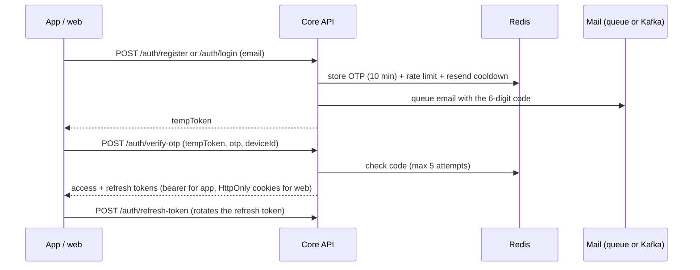

# One Melody

One Melody is a complete music streaming platform: a mobile app, a web player and an
admin dashboard. Behind them are a Spring Boot API, a Django admin API, a Bun/FFmpeg
media pipeline orchestrated by Inngest, and a Kafka (Redpanda) event pipeline with
Kafka Streams services. It runs on two EC2 servers, with Postgres on Neon, Redis on
Upstash and media in S3 behind ImageKit.


## Contents

1. [Features](#features)
2. [Architecture](#architecture)
3. [Services in detail](#services-in-detail)
4. [Media pipeline](#media-pipeline)
5. [Event pipeline](#event-pipeline)
6. [Data model](#data-model)
7. [Authentication and security](#authentication-and-security)
8. [Caching and performance](#caching-and-performance)
9. [API reference](#api-reference)
10. [Repository layout](#repository-layout)
11. [Local development](#local-development)
12. [Configuration](#configuration)
13. [Testing](#testing)
14. [CI/CD and releases](#cicd-and-releases)
15. [Deployment and infrastructure](#deployment-and-infrastructure)
16. [Observability](#observability)
17. [Troubleshooting](#troubleshooting)
18. [Further documentation](#further-documentation)

---

## Features

### For listeners (mobile app and web player)

- **Streaming:** adaptive HLS audio at 128, 240 and 320 kbps, music videos up to 720p, and
  vertical "canvas" loops behind the player.
- **Player:** queue management, gapless handover and optional crossfade between tracks,
  synced lyrics, and resume on another device from the last saved position.
- **Home:** a home screen that streams in section by section over Server-Sent Events:
  recently played, made for you, trending, featured playlists and artists you love. The
  app caches the last home screen and shows it instantly when offline.
- **Discovery:**
  - Algolia search across songs, artists, playlists and lyric lines.
  - Recombee recommendations: for the user, similar songs, song radio and session radio.
  - Mood radio driven by audio features: tempo, energy, valence and danceability.
- **Library:** favourites, followed artists, listening and search history, and personal
  playlists, which can be private or shared by link, saved, or duplicated.
- **Shorts and canvas:** a vertical video feed with likes.
- **Onboarding:** pick favourite artists and genres. Cold-start recommendations are ranked
  from those picks.
- **Sharing:** a public `/song/<id>` page with Open Graph tags, so shared links show a preview.
- **Offline-aware:** the app shows when the server can't be reached. It queues telemetry
  and sends it in batches once it's back.

### For admins (admin dashboard)

- **Catalog:** manage songs, artists and playlists, including the featured flag, reprocessing
  audio or video, and recovering missing media.
- **Uploads:** upload songs with audio, video, cover and canvas, then follow each
  transcoding job step by step. Failed jobs can be retried, cancelled or recovered.
- **Catalog health:** finds songs missing media, lyrics, audio features or index entries,
  and can resync or reprocess them.
- **Search and recommendations:** reindex Algolia and Recombee, per entity or the whole catalog.
- **Users and access:** block, unblock, demote and delete accounts; view and revoke
  sessions; actions gated by role, with typed confirmation for destructive ones.
- **Operations:** a dashboard with stats, system health and a heartbeat from the media
  pipeline. Cascade deletes run as their own tracked jobs.

### Platform

- A transactional outbox and Kafka pipeline keep stats, listening sessions, history and the
  search and recommendation indexes up to date without blocking requests.
- Avro schemas are shared by every JVM service, with a backward-compatibility check in CI.
- Production deploys from promoted `:stable` images, with one-step rollback.
- Runtime secrets can come from AWS Secrets Manager through instance roles, so no keys sit on disk.
- OpenTelemetry traces, metrics and logs from every service, with alert definitions.

---

## Architecture



### How a request flows

1. The app or web player calls `https://api-one-melody.one-org.me`. Caddy terminates TLS and proxies to the core API.
2. The core API checks the JWT (bearer token for the app, HttpOnly cookie for the web) and that the token isn't blacklisted.
3. It answers from the Redis cache where it can, otherwise from Postgres. Recommendations and search go to Recombee and Algolia.
4. Media isn't proxied: clients fetch HLS playlists and segments straight from ImageKit/S3.
5. Listening telemetry goes to Kafka and is processed asynchronously by the stream services.

### Two servers

| Server | Containers | Why it's split this way |
|---|---|---|
| **Core** | `core`, `mail`, `caddy`, `watchtower`, `otel-collector` | Latency-sensitive listener traffic stays on its own machine. |
| **Processing** | `admin`, `process`, `redpanda`, `redpanda-init`, `streams`, `caddy`, `watchtower`, `otel-collector` | Transcoding is CPU-heavy; admin, Kafka and the stream services live next to it, off the listener path. |

Both servers live in one VPC. Kafka (9092) and Schema Registry (8081) bind to the
processing server's private IP. The security group admits only the two instances.

### Services at a glance

| Service | Folder | Stack | Port | Runs on |
|---|---|---|---|---|
| Core API | `coreEngine/` | Spring Boot 4.1, Java 21, JPA, Spring Security, Redis | 9090 (prod) / 8080 (local) | core server |
| Mail worker | `workers/mailEvents/` | Bun, ioredis, SMTP / SES / Resend | – | core server |
| Admin API | `adminBackend/` | Django 6, DRF, Python 3.12, Gunicorn | 8000 | processing server |
| Media pipeline | `audioProcessing/` | Bun, Express, Inngest, FFmpeg | 5010 | processing server |
| Stream services | `streams/` | Spring Boot 4.1, Kafka Streams, Spring Kafka | 8095 | processing server |
| Kafka | Redpanda (`infra/kafka/`) | Kafka API, Schema Registry, HTTP proxy | 9092 / 8081 / 8082 | processing server |
| Event contracts | `communication/` | Avro schemas → generated Java | – | library |
| Web player | `audioFrontend/` | Next.js 16, React 19, Tailwind 4 | 3000 | Vercel |
| Admin dashboard | `adminFrontend/` | Next.js 16, TanStack Query/Table, React Hook Form, Zod | 3001 (local) | Vercel |
| Mobile app | `audioApp/` | Expo SDK 58, React Native, expo-audio | – | iOS / Android |
| Migrations | `migration/` | Flyway, V1–V17 | – | run by hand |

---

## Services in detail

### Core API (`coreEngine/`)

The listener-facing API: about 95 endpoints across auth, catalog, playback, library,
home, search, recommendations and telemetry.

- **Packages:** `Controllers` (REST), `Services` (business logic), `Repository` (Spring
  Data JPA), `Entity`, `Dto`, `Security`, `Configuration`, `Cache`, `Recommendation`
  (Recombee and the ranking engine), `AlgoliaSearch`, `Events` (in-process listeners and
  the Kafka producers in `Events/Kafka`), `Aspects` (central logging with slow-call warnings).
- **Home over SSE:** `GET /api/home/stream` sends each home section as soon as it's ready,
  without holding a database connection open for the whole stream.
- **Recommendations:**
  - Recombee supplies the candidates.
  - `RecommendationRankingEngine` re-ranks them using audio-feature similarity and genre preferences.
  - Mood radio maps a mood to target tempo, energy, valence and danceability.
- **Pagination:** counts come from a `pagination_metadata` table kept in sync on writes,
  so list endpoints never run `count(*)` over large tables.
- **Telemetry:** controlled by `melody.events.mode`; see [Event pipeline](#event-pipeline).
  - `LEGACY`: in-process `@Async` listeners update Recombee, Algolia and stream counts.
  - `DUAL` and `KAFKA`: the same endpoints produce Avro events instead.
- **Runs on virtual threads** (Java 21), with graceful shutdown and actuator health probes
  for liveness and readiness. The probes deliberately don't ping the database, so Neon can sleep.

### Admin API (`adminBackend/`)

Django + DRF, running under Gunicorn. Models are `managed = False`: Flyway in `migration/`
owns the schema, and Django never runs migrations.

| App | Responsibility |
|---|---|
| `accounts` | Admin auth (email OTP, Redis-backed sessions), admin user management, listener account moderation |
| `catalog` | Songs, artists, playlists, catalog health, Algolia/Recombee reindexing, catalog change events (outbox) |
| `jobs` | Upload/transcoding jobs and delete jobs: status lists, retry, recover, metadata sync |
| `webhooks` | Endpoints the media pipeline calls at each step (pre-signed upload URLs, transcoded, features, indexed, finalize, failed, delete steps) |
| `dashboard` | Stats, system health, the pipeline heartbeat, admin search |
| `core` | Shared services: Redis sessions, Inngest client, S3, ImageKit, Algolia, Recombee, outbox, pagination |

Admin sessions live in Redis and Redis is authoritative: a session, OTP or block that
isn't in Redis is treated as revoked. The in-memory copy is only a fallback for when Redis
is down, which makes revocation work across all Gunicorn workers.

### Media pipeline (`audioProcessing/`)

A Bun service exposing Inngest functions plus a small Express API (`/api/inngest`,
`/api/jobs/:jobId/cancel`, `/api/jobs/:jobId/cleanup`). Each step reports progress to the
admin API through webhooks, and every job function can be cancelled by an
`audio/job.cancel` event. Details are in [Media pipeline](#media-pipeline).

### Mail worker (`workers/mailEvents/`)

Sends OTP emails from the Redis `mail_queue`:
- **Waiting:** a single blocking `BLPOP` of up to 55 s, so an idle worker costs a few Redis commands a minute.
- **Retries:** failed sends wait in a delayed sorted set and are tried 3 times with backoff.
- **Dead letters:** after that they go to a DLQ, which never stores the code.
- **Providers:** SMTP (Gmail), Amazon SES or Resend, chosen with `MAIL_PROVIDER`.
- **Metrics:** sent, failed, DLQ and queue length, exported over OpenTelemetry.

The stream services' `notification` profile replaces this worker once the event pipeline is in `KAFKA` mode.

### Stream services (`streams/`)

One Spring Boot app; `STREAMS_PROFILES` picks which services run:
`outbox-relay`, `stats`, `activity`, `sync` and `notification`. Details are in [Event pipeline](#event-pipeline).

### Web player (`audioFrontend/`)

Next.js 16 App Router. Routes: `login`, `signup`, `home`, `albums`, `artists`,
`playlists`, `my-playlists`, `history` and the public `song/[id]` share page. Auth uses
HttpOnly cookies set by the core API; no tokens are kept in `localStorage`.

### Admin dashboard (`adminFrontend/`)

Next.js 16. Pages: dashboard, `songs`, `artists`, `playlists`, `jobs`, `catalog-health`, `users`.
- **Data:** fetching and polling go through TanStack Query. The jobs page refreshes every 15 s, and only while the tab is visible.
- **Tables and forms:** one shared TanStack Table component, with server-side paging, filters and CSV export. Forms use React Hook Form with Zod schemas.
- **Permissions:** actions show according to the admin's role.
- **Tests:** Playwright smoke tests run against a mocked backend.

### Mobile app (`audioApp/`)

Expo Router app with tabs for Home, Search, Favourites and Profile. Other screens:
- **Library:** album, artist, playlist, user playlist and song detail screens, plus favourites.
- **Media:** lyrics, canvas and shorts.
- **Account:** onboarding, login, register and OTP verification.

How the app works inside:
- **Player:** `src/service/player/` holds the player engine (expo-audio): queue, gapless
  handover, crossfade, and progress reporting (saved locally every 5 s, to the server every 60 s).
- **Telemetry:** `src/service/telemetryQueue.ts` gives each interaction a UUID v7 and stores it in
  AsyncStorage. It sends up to 50 at a time to `POST /api/interaction/batch` every 10 s, on track
  change, and when the app goes to the background or comes back. If the server has no batch
  endpoint, it falls back to the single-event endpoints.
- **Data loading:** TanStack Query, with the last home screen persisted for instant offline start.
- **Tests:** Jest via `jest-expo`, 118 tests.

---

## Media pipeline



- **Validation first:** each input is checked with `ffprobe` before transcoding, so corrupt uploads fail fast.
- **Audio:** HLS with three AAC variants, 128, 240 and 320 kbps (44.1 kHz stereo), plus a master playlist.
  - If only a video is uploaded, the audio track is extracted from it.
- **Video:** HLS ladder of 1080p, 720p, 480p and 360p profiles, capped at 720p and at the source height.
  - Hardware encoding uses VideoToolbox, NVENC, Quick Sync or VA-API when available, and falls back to `libx264`.
- **Canvas:** a vertical 720×1280 loop at 800 kbps.
- **Concurrency:** limited by `CONCURRENT_TRANSCODING_LIMIT`. Temporary files are tracked
  and cleaned up even when a step fails.
- **Progress:** each step calls the admin API: `transcoding-started`, `transcoded`,
  `audio-features`, `save-recommendation`, `save-search`, `finalize` or `failed`. The admin
  dashboard shows those steps live, with timings.
- **Deletes** run as their own chain: `delete-from-algolia` → `delete-from-recombee` →
  `delete-from-imagekit` → `delete-from-s3` → `finalize-delete`, tracked as a delete job.
- **Cancel:** every job function stops on `audio/job.cancel` (Inngest `cancelOn`).
- **Heartbeat:** the pipeline sends a heartbeat to the admin API every 60 s, which the dashboard shows.

---

## Event pipeline

```
 app ──POST /api/interaction/batch──▶ core API ──Avro──▶ Redpanda ──▶ streams/ (one JVM)
                                      (telemetry)                     ├─ stats        → song_stats, song_daily_stats, artist_stats
 core API / admin API                                                 ├─ activity     → listening_sessions, user_history (+ total_streams)
   change + outbox row in one transaction ──▶ outbox_events           ├─ sync         → Recombee batch API, Algolia partial updates
                                   outbox-relay ──▶ Redpanda          └─ notification → SMTP / SES / Resend (retry topic, DLQ)
```

### Topics

| Topic | Value (Avro) | Key | Produced by | Retention |
|---|---|---|---|---|
| `listening.play.v1` | `PlayEvent` | user id | core API | 7 days |
| `listening.skip.v1` | `SkipEvent` | user id | core API | 7 days |
| `search.interaction.v1` | `SearchInteraction` | user id | core API | 7 days |
| `queue.change.v1` | `QueueChange` | user id | core API | 3 days |
| `engagement.feedback.v1` | `SongFeedback` (dislike, share) | user id | core API | 7 days |
| `engagement.favourite.v1` | `FavouriteChanged` | user id | outbox (core) | 7 days |
| `engagement.playlist-song.v1` | `PlaylistSongChanged` | user id | outbox (core) | 7 days |
| `social.artist-follow.v1` | `ArtistFollowChanged` | user id | outbox (core) | 7 days |
| `user.lifecycle.v1` | `UserLifecycleEvent` | user id | outbox (core) | 7 days |
| `catalog.song.v1` | `SongChanged` | song id | outbox (admin) | compacted |
| `notification.email.v1` | `EmailRequested` | address hash | outbox (core, admin) | 1 day |
| `notification.email.retry.v1` | `EmailRequested` | address hash | notification | 1 day |
| `stats.song.v1` | `SongStats` | song id | stats | compacted |
| `stats.song-daily.v1` | `SongDailyStats` | song id + day | stats | 90 days |
| `stats.artist.v1` | `ArtistStats` | artist id | stats | compacted |
| `activity.session.v1` | `ListeningSession` | user id + start | activity | compacted |
| `pipeline.dlq.v1` | original bytes + error headers | original | all consumers | 14 days |
| `outbox.wakeup.v1` | plain string | writer | core and admin APIs | 1 hour |

Topics are defined in [`infra/kafka/topics.yaml`](infra/kafka/topics.yaml) and applied by
`apply-topics.sh`, which only creates or updates, never deletes. Schemas live in
`communication/src/main/avro`.

### How it stays correct

- **Exactly-once where it matters:**
  - Every event carries an `EventMeta` with a UUID v7 `event_id`.
  - Kafka Streams runs with `exactly_once_v2` and drops duplicates for 24 hours.
  - `user_history` is keyed on the event id.
  - The stats sinks write absolute totals, never increments, so replaying a topic can't double-count.
- **Outbox:** state changes and their events commit together.
  - The relay publishes in batches (`FOR UPDATE SKIP LOCKED`), waits for Kafka's acks, then marks the rows sent.
  - Email payloads are blanked once sent, and sent rows are deleted after 3 days.
- **No database polling:** after each commit, writers send a small wake-up record to
  `outbox.wakeup.v1` (Django uses the Redpanda HTTP proxy). The relay sweeps when it gets
  one, once at start-up, and every 6 hours as a safety net, so Neon can still suspend.
- **Outages:**
  - If Kafka is down, telemetry answers 503 and the app keeps the events for later.
  - Favourites and other state changes still save; their outbox rows are published once Kafka is back.
  - OTP emails fall back to the Redis mail queue after 30 s, so login never waits on Kafka.
- **Schema safety:** `SchemaCompatibilityTest` enforces the same BACKWARD rule as Schema Registry, before merge.

### Modes

`EVENTS_MODE` on the core and admin APIs:

| Mode | Behaviour |
|---|---|
| `LEGACY` (default) | Today's in-process path. No Kafka needed. |
| `DUAL` | The legacy path does the work and events are also sent, for a week of comparison. Kafka errors never fail a request. |
| `KAFKA` | Events only; the stream services do the work. Turn on `STREAMS_HISTORY_SINK_ENABLED` and `STREAMS_SYNC_ENABLED` at the same time. |

The step-by-step rollout and rollback are in [`infra/kafka/README.md`](infra/kafka/README.md).

---

## Data model

The schema is owned by Flyway (`migration/src/main/resources/db/migration`, V1–V17).
Every migration is additive.

| Area | Tables |
|---|---|
| Users and auth | `users`, `admin_users`, `sessions` |
| Catalog | `songs`, `artists`, `playlists`, `playlist_songs`, `song_metadata` (stream totals), `artist_metadata` (follower totals) |
| Library | `user_playlists`, `user_playlist_songs`, `user_saved_playlists`, `user_favourite_songs`, `artist_follow_events` |
| Activity | `user_history`, `user_search_history`, `user_shorts_likes`, `user_genre_preferences` |
| Media jobs | `jobs` (upload/transcode pipeline, per-step timings, audio features), `delete_jobs` |
| Events | `outbox_events` |
| Stream outputs | `song_stats`, `song_daily_stats`, `artist_stats`, `listening_sessions` |
| Infrastructure | `pagination_metadata` (O(1) list counts) |

Recent migrations:
- **V15:** copies audio features onto `songs`, for ranking and mood radio.
- **V16:** the outbox table.
- **V17:** the stream-output tables.

Apply migrations before deploying code that needs them: the core API runs with
`ddl-auto: validate` and won't start against an older schema.

---

## Authentication and security

### Listener sign-in (email OTP, no passwords)



- **Tokens:**
  - HS256 JWTs. Web cookies last 1 hour for the access token and 7 days for the refresh token.
  - Sessions are stored per device and can be listed or revoked under `/api/user/sessions`.
  - Logout adds the token to a Redis blacklist, which is checked on every request.
- **Rate limits** (per IP, per minute):
  - Register 10, login 15, verify 20, resend 5.
  - Resending a code has a 60 s cooldown.
  - Telemetry has its own in-memory limit per user (300 events a minute).
- **Access rules:** everything under `/api/**` needs a valid token; only `/auth/**` and the health probes are public.
- **Web apps:** both use HttpOnly cookies, so no tokens sit in browser storage.
- **Admin auth:** a separate email-OTP flow with Redis sessions and roles. Destructive
  actions need a typed confirmation in the dashboard.
- **Secrets:**
  - Locally, services read gitignored `.env` files.
  - In production they can load from AWS Secrets Manager through the instance's IAM role; see [`infra/SECRETS.md`](infra/SECRETS.md).
  - Never commit `.env` files or the `.pem` key.

---

## Caching and performance

| Cache (Redis) | TTL |
|---|---|
| `songs`, `artists` | 30 min |
| `featured_songs`, `playlists`, `artist_lists`, `playlist_lists`, `artist_songs`, `popular_videos`, `related_videos`, `canvas_featured` | 15 min |
| `trending_songs`, `trending_videos` | 10 min |
| `paginationMetaData` (default) | 10 min |
| `lyrics` | 30 days |

Cache keys are versioned (`v4:<cache>::<key>`), so a format change never reads stale entries.

### Running cheaply on free tiers

- **Neon (Postgres)** suspends compute after 5 minutes without activity, and compute
  hours are the free-tier limit. So:
  - the connection pool keeps no idle connections (`minimum-idle: 0`);
  - health probes don't query the database;
  - the stream sinks open connections only for a batch;
  - the outbox relay is woken by Kafka instead of polling.
- **Upstash (Redis)** bills every command, including a blocking read that times out empty. So:
  - the mail worker blocks for up to 55 s per read;
  - the processing heartbeat runs once a minute;
  - the admin jobs page polls only while visible;
  - admin sessions are renewed at most every 10 minutes;
  - telemetry rate limits are in memory.

---

## API reference

All paths are relative to the core API. Everything except `/auth/**` and `/actuator/health` needs a token.

| Area | Endpoints |
|---|---|
| **Auth** | `POST /auth/register`, `/auth/login`, `/auth/verify-otp`, `/auth/resend-otp`, `/auth/refresh-token`, `/auth/logout` |
| **Profile and sessions** | `GET`/`PUT /api/user/profile`; `GET /api/user/sessions`, `DELETE /api/user/sessions/{id}`, `POST /api/user/sessions/revoke-others`, `POST /api/user/sessions/logout` |
| **Home** | `GET /api/home/stream` (Server-Sent Events) |
| **Songs** | `GET /api/songs` (paged, filters), `/api/songs/{id}`, `/api/songs/trending`, `/api/songs/featured`, `/api/songs/videos`, `/api/songs/albums` |
| **Artists** | `GET /api/artists`, `/api/artists/{id}`, `/api/artists/{id}/songs`, `/api/artists/search`, `/api/artists/onboarding-list`; `POST /api/artists/onboarding`; `POST /api/artists/{id}/follow`, `/unfollow`, `DELETE /api/artists/{id}/follow`, `GET /api/artists/{id}/follow-status` |
| **Playlists (curated)** | `GET /api/playlists`, `/api/playlists/{id}`, `/api/playlists/{id}/songs` |
| **User playlists** | `GET`/`POST /api/user/playlists`; `GET`/`PUT`/`DELETE /api/user/playlists/{id}`; `PATCH /{id}/privacy`; `GET /{id}/songs`, `POST /{id}/songs`, `DELETE /{id}/songs/{songId}`; `POST`/`DELETE /{id}/save`, `GET /{id}/saved`; `POST /{id}/duplicate`; `GET /api/user/playlists/shared/{tokenOrId}` and `/songs` |
| **Videos and canvas** | `GET /api/videos`, `/api/videos/trending`, `/api/videos/popular`, `/api/videos/{id}/related`, `/api/videos/artist/{artistName}`; `GET /api/canvas/feed`, `/api/canvas/featured`, `/api/canvas/liked`, `/api/canvas/liked/songs`; `GET`/`POST /api/canvas/{songId}/like` |
| **Lyrics** | `GET /api/lyrics/{songId}` |
| **Search** | `GET /api/search` (Algolia: songs, artists, playlists, lyrics) |
| **Recommendations** | `GET /api/recommendations/user`, `/similar/{songId}`, `/radio`, `/radio/session`, `/radio/mood` |
| **History and progress** | `GET /api/user/history`, `/api/user/history/recent`; `GET`/`POST`/`DELETE /api/user/history/search` (+ `/{id}`); `POST`/`DELETE /api/user/progress`, `GET /api/user/progress/resume` |
| **Preferences** | `GET`/`POST /api/preferences/genres` |
| **Favourites** | `POST`/`DELETE /api/interaction/favourite/{songId}`, `GET /api/interaction/favourites` |
| **Telemetry** | `POST /api/interaction/play`, `/skip`, `/search-play`, `/search-click`, `/queue-add`, `/queue-remove`, `/dislike`, `/share`, and `/batch` (up to 50 events, `DUAL`/`KAFKA` mode) |
| **Health** | `GET /actuator/health`, `/actuator/health/liveness`, `/actuator/health/readiness` |

Admin API route groups (under `https://api-admin-one-melody.one-org.me`):

| Group | Prefix |
|---|---|
| Admin auth and sessions | `admin/auth/...` (login, register, verify-otp, refresh, me, sessions) |
| Listener accounts | `admin/account/...` (list, block, unblock, demote, delete, sessions) |
| Catalog | `admin/song/...`, `admin/artist/...`, `admin/playlist/...`, `admin/catalog/...` (health, reindex, sync) |
| Jobs | `admin/jobs/...` (summary, queues, by status, retry, recover), `admin/delete-jobs/...` |
| Pipeline webhooks | `webhook/internal/...` (pre-signed uploads), `webhook/job/{id}/...`, `webhook/delete/{type}/{id}/...` (API-key protected) |
| Dashboard | `admin/dashboard/stats`, `admin/system/health`, `admin/search`, `api/telemetry/heartbeat`, `health` |

---

## Repository layout

```
coreEngine/          Spring Boot core API
communication/       Avro event schemas + generated Java (shared by coreEngine and streams)
streams/             Outbox relay and Kafka Streams services (one app, Spring profiles)
adminBackend/        Django admin API (admin/ holds the project and apps)
audioProcessing/     Bun media pipeline: functions/ (Inngest), lib/transcode (FFmpeg), lib/s3
workers/mailEvents/  Bun mail worker (Redis queue → SMTP / SES / Resend)
audioFrontend/       Next.js web player
adminFrontend/       Next.js admin dashboard
audioApp/            Expo mobile app (src/app routes, src/service player and API clients)
migration/           Flyway migrations, the single source of truth for the schema
Docker/              Production compose files and deploy scripts: core/ and admin/ servers, RELEASES.md
infra/               Terraform (environments/, modules/), kafka/ topics + runbook,
                     observability/ alerts, scripts/, SECRETS.md
assets/              Architecture diagram (SVG and interactive HTML)
docker-compose.yml   Local dev services: Redpanda, topic setup, Redpanda Console, Inngest dev server
pom.xml, mvnw        Root Maven build for communication, coreEngine and streams
```

---

## Local development

### Prerequisites

- Java 21 (the Maven wrapper downloads Maven)
- Bun 1.3+ and Node 20+
- Python 3.12 and [uv](https://docs.astral.sh/uv/)
- Docker (for Redpanda, Inngest and the container tests)
- A Postgres database: a Neon branch or a local Postgres 17
- A Redis: Upstash or a local `redis:7`
- FFmpeg on your `PATH` (for the media pipeline)

### 1. Configure

Each service reads a gitignored `.env` in its folder. Start from the matching example and
fill in your own values:

| Service | Example |
|---|---|
| Core API | `coreEngine/.env.example` (or `Docker/core/core.env.example`) |
| Admin API | `Docker/admin/admin.env.example` → `adminBackend/.env` (missing keys fall back to `coreEngine/.env`) |
| Media pipeline | `Docker/admin/process.env.example` → `audioProcessing/.env` |
| Mail worker | `Docker/core/mail.env.example` → `workers/mailEvents/.env` |
| Stream services | `Docker/admin/streams.env.example` → `streams/.env` |

### 2. Database schema

```bash
cd migration && ../mvnw spring-boot:run
```

Run this first, and again whenever new migrations are pulled.

### 3. Local infrastructure

```bash
docker compose up -d inngest                    # Inngest dev server, http://localhost:8288
docker compose up -d redpanda redpanda-init     # Kafka localhost:19092, Schema Registry :18081
docker compose --profile console up -d console  # optional: Redpanda Console, http://localhost:8089
```

Kafka is only needed when `EVENTS_MODE` is `DUAL` or `KAFKA`.

### 4. Run the services

```bash
./mvnw -pl coreEngine -am spring-boot:run                    # core API        http://localhost:8080
./mvnw -pl streams -am spring-boot:run                       # stream services (MAIL_PROVIDER=log)
cd adminBackend/admin && uv run python manage.py runserver 0.0.0.0:8000
cd audioProcessing && bun install && bun run dev             # media pipeline  http://localhost:5010
cd workers/mailEvents && bun install && bun run dev          # mail worker
cd audioFrontend && bun install && bun run dev               # web player      http://localhost:3000
cd adminFrontend && bun install && bun run dev -- -p 3001    # admin dashboard http://localhost:3001
cd audioApp && npm install && npx expo start                 # mobile app (Expo Go or a dev build)
```

> The Java modules build from the **repo root**, because `coreEngine` and `streams` depend
> on `communication/`. Always use the root `./mvnw` with `-pl <module> -am`.

---

## Configuration

These are the most important settings. The `.env.example` files list every key.

| Variable | Used by | Meaning |
|---|---|---|
| `DB_URL`, `DB_USER`, `DB_PASSWORD` | core, admin, streams, migration | Postgres (JDBC URL for the JVM services) |
| `REDIS_HOST`, `REDIS_PORT`, `REDIS_PASSWORD`, `REDIS_SSL_ENABLED` | core, admin, mail, processing | Upstash or local Redis |
| `JWT_SECRET` | core | HS256 signing key (at least 32 bytes) |
| `EVENTS_MODE` | core, admin | `LEGACY` / `DUAL` / `KAFKA` |
| `KAFKA_BOOTSTRAP_SERVERS`, `SCHEMA_REGISTRY_URL` | core, streams | Redpanda addresses |
| `KAFKA_REST_PROXY_URL` | admin | Redpanda HTTP proxy, for the outbox wake-up |
| `STREAMS_PROFILES` | streams | Which stream services run |
| `STREAMS_HISTORY_SINK_ENABLED`, `STREAMS_SYNC_ENABLED` | streams | Turn on together with `EVENTS_MODE=KAFKA` |
| `ALGOLIA_APP_ID`, `ALGOLIA_API_KEY`, `ALGOLIA_INDEX_NAME` | core, admin, processing, streams | Search index |
| `RECOMBEE_DATABASE_ID`, `RECOMBEE_DATABASE_SECRET`, `RECOMBEE_DATABASE_REGION` | core, admin, streams | Recommendations |
| `INNGEST_EVENT_KEY`, `INNGEST_SIGNING_KEY`, `INNGEST_DEV` | admin, processing | Inngest (the admin API refuses to start in production without the keys) |
| `S3_TEMP_BUCKET`, `S3_PRODUCTION_BUCKET`, `AWS_*` | admin, processing | Raw uploads and published media |
| `IMAGEKIT_*` | core, admin, processing | Media CDN and image uploads |
| `MAIL_PROVIDER`, `SMTP_*`, `RESEND_API_KEY`, `MAIL_FROM` | mail, streams | `smtp`, `ses`, `resend` or `log` |
| `COOKIE_DOMAIN`, `COOKIE_SECURE`, `CORS_ALLOWED_ORIGINS` | core | Web cookie and CORS settings |
| `DJANGO_SECRET_KEY`, `DJANGO_DEBUG` | admin | Django settings (debug is off unless set) |
| `CONCURRENT_TRANSCODING_LIMIT` | processing | Parallel transcodes |
| `OTEL_SERVICE_NAME`, `OTEL_EXPORTER_OTLP_ENDPOINT` | all | OpenTelemetry export |

---

## Testing

| Service | Command | What it covers |
|---|---|---|
| Core API | `./mvnw -pl coreEngine -am test` | About 220 tests: controllers, services, security, Redis, event producers, and a Testcontainers Redpanda test |
| Stream services | `./mvnw -pl streams -am test` | Kafka Streams topology tests (TopologyTestDriver), sync mapping, email retries, and a Postgres + Redpanda test that runs every Flyway migration |
| Event schemas | `./mvnw -pl communication test` | UUID v7 ids, outbox conversion, backward compatibility against `schema-snapshots/` |
| Admin API | `cd adminBackend/admin && uv run python manage.py test` | 105 tests: auth, sessions, catalog, jobs, webhooks, outbox |
| Media pipeline | `cd audioProcessing && bun test` | Transcoding, media validation, hardware-encoder detection, audio features, the transcode limiter, job metrics, API-key auth, lyrics, secrets loading |
| Mail worker | `cd workers/mailEvents && bun test` | Queue handling, retries, DLQ, providers |
| Mobile app | `cd audioApp && npm test` | 118 tests: queue logic, player math, telemetry queue, formatting |
| Admin dashboard | `cd adminFrontend && bun run test:e2e` | Playwright smoke tests with a mocked backend |
| Web apps | `bunx tsc --noEmit && bun run build` | Type check and production build |

Tests that need Docker skip themselves when Docker isn't running.

After a compatible schema change, refresh the snapshots and commit them:

```bash
./mvnw -pl communication test -Dschemas.update=true
```

---

## CI/CD and releases

[`.github/workflows/work.yml`](.github/workflows/work.yml) detects which services changed
and runs only their tests. On a push to `main`, it builds the changed services' images
(`core`, `mail`, `admin`, `audioprocessing`, `streams`) and pushes them to Docker Hub as
`:latest` and `:sha-<commit>`.

Production runs the **`:stable`** tag. To ship:

1. Merge to `main` and wait for CI.
2. Apply any new Flyway migrations to production with the migration app.
3. Run **Actions → Promote to Production**, choosing a service or `all`, and optionally a commit SHA.
4. Watchtower on each server sees the new `:stable` within about 30 seconds and restarts that container.

The previous release stays available as `:stable-previous` for one-step rollback. Details
are in [`Docker/RELEASES.md`](Docker/RELEASES.md).

---

## Deployment and infrastructure

- **Terraform** in `infra/` covers:
  - the VPC, two public subnets, the security group and the two EC2 instances with Elastic IPs;
  - the SSH key and S3 buckets;
  - the Kafka security-group rules and a 30 GB encrypted volume for Redpanda;
  - Secrets Manager secrets and per-instance IAM roles.

  The state backend is set in `infra/environments/production/backend.tf`.

  ```bash
  cd infra/environments/production
  terraform init
  terraform plan
  terraform apply
  ```

- **Deploy scripts:** `Docker/core/deploy.sh` and `Docker/admin/deploy.sh` copy the compose
  file, Caddyfile and env files to the server and start the stack. The processing script
  also mounts the Kafka volume at `/mnt/kafka` and sets Redpanda's advertised private IP.
- **TLS:** Caddy on each server gets certificates automatically.
- **Secrets:** to move from `.env` files to AWS Secrets Manager, follow [`infra/SECRETS.md`](infra/SECRETS.md):
  1. Apply the Terraform.
  2. Set the values once.
  3. Rotate every key that has been in a file.

---

## Observability

- Every service exports traces, metrics and logs over OTLP to an OpenTelemetry collector
  on its server. The JVM services use the OpenTelemetry Java agent.
- The collectors tag each signal with the server's role and environment.
- Alert definitions in [`infra/observability/alerts.yml`](infra/observability/alerts.yml)
  (documented in its README):
  - HTTP 5xx rate above 2%
  - home and recommendation p95 latency above 1.5 s
  - audio job failures and step retries
  - a missing pipeline heartbeat
  - mail sent to the DLQ, and mail send failures
- Stream consumer lag and the DLQ can be inspected with `rpk group describe <group>` and
  `rpk topic consume pipeline.dlq.v1` on the processing server.

---

## Troubleshooting

| Symptom | Likely cause and fix |
|---|---|
| Every API call returns **502** and the core container keeps restarting | The core API can't reach Postgres. Check `docker logs core`. If it shows "exceeded the quota", restore the Neon plan's quota. |
| Core API fails to start with a schema validation error | A migration wasn't applied. Run the migration app against that database. |
| `Could not find artifact me.oneorg:communication` | You built a module on its own. Build from the repo root with `./mvnw -pl <module> -am`. |
| Container tests are skipped | Docker isn't running, or Testcontainers can't find it. Set `DOCKER_HOST=unix://$HOME/.docker/run/docker.sock` on macOS. |
| Admin API exits with "INNGEST_EVENT_KEY, INNGEST_SIGNING_KEY not set" | Set both keys, or `INNGEST_DEV=1` for local development. |
| Telemetry returns **503** | `EVENTS_MODE=KAFKA` and Kafka is unreachable. The app retries; check Redpanda on the processing server. |
| Login codes arrive slowly | The outbox relay may be down. The core falls back to the Redis mail queue after 30 s; check the `streams` and `mail` containers. |
| Upstash or Neon usage jumps | Look for a new polling loop or a held connection; see [Running cheaply on free tiers](#running-cheaply-on-free-tiers). |

---

## Further documentation

| Document | Covers |
|---|---|
| [`infra/kafka/README.md`](infra/kafka/README.md) | Event pipeline modes, rollout, rollback, local Kafka |
| [`infra/SECRETS.md`](infra/SECRETS.md) | AWS Secrets Manager names, access, setup, rotation |
| [`infra/README.md`](infra/README.md) | Terraform environments and modules |
| [`infra/observability/README.md`](infra/observability/README.md) | Alerts and the signals they use |
| [`Docker/RELEASES.md`](Docker/RELEASES.md) | Image tags, promotion and rollback |
| [`assets/architecture_diagram.svg`](assets/architecture_diagram.svg) | Architecture diagram |

## License

MIT. Built by [Karan Kumar](https://github.com/karankumar786786).
