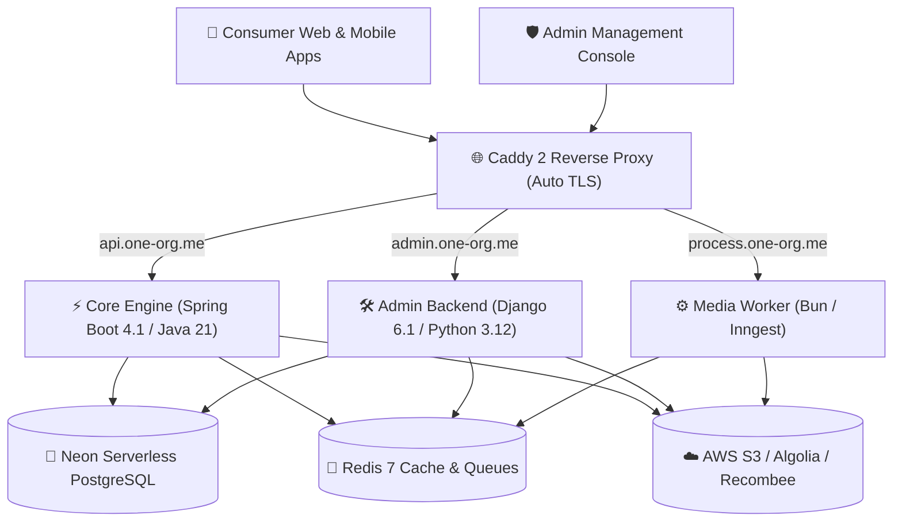
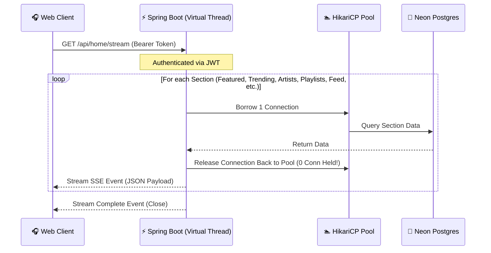
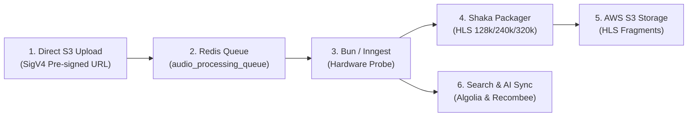
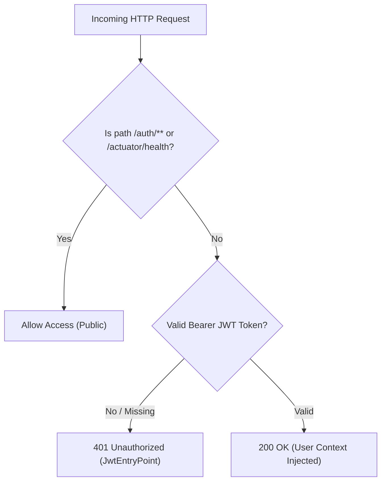

# 🎵 One Melody — Cloud-Native Enterprise Audio & Video Streaming Platform

[](https://openjdk.org/projects/jdk/21/)
[](https://spring.io/projects/spring-boot)
[](https://www.python.org/)
[](https://www.djangoproject.com/)
[](https://github.com/astral-sh/uv)
[](https://nextjs.org/)
[](https://react.dev/)
[](https://tailwindcss.com/)
[](https://www.typescriptlang.org/)
[](https://bun.sh/)
[](https://expressjs.com/)
[](https://caddyserver.com/)
[](https://aws.amazon.com/s3/)
[](https://www.algolia.com/)
[](https://www.recombee.com/)
[](https://imagekit.io/)
[](https://www.inngest.com/)
[-DC382D.svg?style=flat&logo=redis)](https://redis.io/)
[](https://www.postgresql.org/)
[-success.svg?style=flat)](https://github.com/karankumar786786/AudioMelodySpringboot)

**One Melody** is an enterprise-grade, distributed multimedia streaming platform engineered for high concurrency, low-latency adaptive playback, and automated cloud operations. Built with modern microservice design principles, it couples high-performance **Java 21 / Spring Boot 4.1** streaming gateways (`api.one-org.me`) with a dedicated **Python 3.12 / Django 6.1** administrative command microservice (`admin.one-org.me`), **Node.js / Bun / Inngest** asynchronous media processing workers (`process.one-org.me`), **Google Shaka Packager** multi-bitrate HLS/DASH chunking, and dual **Next.js 16** frontends (`adm.one-org.me` and consumer apps) delivering a pitch-black OLED monochrome aesthetic.

---

## 🏛️ System Architecture



---

## 📦 Verified Tech Stack & Version Matrix

| Subsystem / Service | Runtime / Language | Core Framework | Key Dependencies & Tooling | Production Role |
| :--- | :--- | :--- | :--- | :--- |
| **`coreEngine`** | Java 21 LTS | **Spring Boot 4.1.1** | Spring Security, Spring Data JPA, HikariCP, JJWT 0.12.6, Algolia 4.5.4, Recombee 4.1.0, Bucket4j 8.14.0 | High-Concurrency Audio Gateway (`api.one-org.me`) |
| **`adminBackend`** | Python 3.12 | **Django 6.1.1** | Django REST Framework 3.18.1, `uv`, Gunicorn 26.2, Boto3 1.43, Redis 8.1, dj-database-url | Admin Command Center & Ingestion Pipeline (`admin.one-org.me`) |
| **`audioFrontend`** | TypeScript 5.x | **Next.js 16.2.3** / React 19.2.4 | Tailwind CSS 4, TanStack Query 5.99, TanStack Store 0.10, HLS.js 1.6.16, Shaka Player 5.2.8, Framer Motion 12 | Consumer Streaming Web App (`audio.one-org.me`) |
| **`adminFrontend`** | TypeScript 5.x | **Next.js 16.2.3** / React 19.2.4 | Tailwind CSS 4, Framer Motion 12, Biome 2.2, Lucide React 1.16 | Administration & Job Monitoring Console (`adm.one-org.me`) |
| **`audioProcessing`** | Bun 1.3+ | **Express 5.2.1** | Inngest 4.14.0, AWS SDK S3 3.1101, IORedis 6.0, FFmpeg 6.0, Google Shaka Packager 3.0 | Hardware Transcoding & Multi-Bitrate HLS Chunker |
| **`workers/mailEvents`**| Bun 1.3+ | Native Bun Worker | Nodemailer 9.0.5, IORedis 6.0 | Redis Queue Consumer for OTP & Mail Notifications |
| **`migration`** | Java 17/21 | **Spring Boot 4.1.1** | Flyway Migration Engine, PostgreSQL Driver | Database Schema Migrations & Baseline Audits |
| **`Edge Gateway`** | Native Binary | **Caddy 2.x** | Let's Encrypt Auto-TLS, Reverse Proxy, CORS Gateway | Production Ingress Reverse Proxy (`13.126.178.32`) |

---

## 🔄 Recent Changes & Engineering Upgrades

We recently completed a major architectural overhaul across the entire platform to optimize database resource utilization, eliminate latency bottlenecks, enhance security, and resolve legacy cache issues:

### 1. Progressive SSE Streaming with Zero DB Connection Hoarding
- **Problem**: When loading the home page, the client previously dispatched 7–10 simultaneous REST queries, flooding the backend and exhausting the database connection pool.
- **Solution**: Replaced multi-request polling with a single progressive SSE stream (`GET /api/home/stream`) powered by Java 21 Virtual Threads.
- **Fetch ➔ Release ➔ Emit Cycle**: Each section query borrows a database connection from HikariCP, executes the query, and **immediately returns the connection to the pool** before transmitting the event across the network socket.
- **Impact**: Zero database connections are held during network streaming. Maximum 1 connection is utilized during active query execution. Client disconnects (`AtomicBoolean isClosed`) instantly halt remaining queries.

### 2. Neon Scale-to-Zero HikariCP Tuning
- **Problem**: Serverless Neon PostgreSQL charges per active compute second. Probes and unmanaged connections prevented instances from sleeping.
- **Solution**: Explicitly configured HikariCP (`maximum-pool-size: 20`, `minimum-idle: 2`, `idle-timeout: 60s`, `max-lifetime: 240s`, `leak-detection-threshold: 30s`).
- **Connection Leak Protection**: Set `open-in-view: false` across Spring JPA and added `DataSourceConfig` to log pool metrics and Hikari configuration on startup.

### 3. Elimination of Table Scan `count(*)` Queries ($\mathcal{O}(1)$ Pagination)
- **Problem**: `SongsApiService`, `ArtistApiService`, and `PlaylistApiService` previously fell back to `repository.count()`, causing full sequential table/index scans on growing catalogs.
- **Solution**: Removed all fallback `count(*)` queries. Catalog metadata is now resolved in $\mathcal{O}(1)$ time directly from the indexed `pagination_meta_data` table and Redis cache via `PaginationMetaDataService`.
- **Impact**: Pagination latency dropped from ~150ms to **under 2ms**.

### 4. Redis Cache Versioning (`v2:`) & Jackson Polymorphic Serializer
- **Problem**: Redis previously logged `JsonToken.START_ARRAY` deserialization warnings due to legacy un-typed array keys conflicting with polymorphic type wrappers.
- **Solution**: In `RedisConfig`, isolated the cache namespace using a `v2:` key prefix (`v2:featured_songs`, `v2:trending_songs`, etc.) and configured `GenericJacksonJsonRedisSerializer.builder()` with `@class` type support.
- **Self-Healing**: Added an automated eviction error handler that deletes corrupted or malformed keys on access without breaking the application.

### 5. Strict Security Lockdown (100% Authentication on All `/api/**` Endpoints)
- **Problem**: Search (`/api/search`) and home endpoints were previously publicly accessible without tokens.
- **Solution**: Removed `permitAll()` on all internal API endpoints in `SecurityConfig`. Only `/auth/**` (login, register, verify-otp, refresh) and `/actuator/health` remain public.
- **Enforcement**: Any unauthenticated or forged request to `/api/**` immediately returns `HTTP 401 Unauthorized` with a standardized JSON error response.

### 6. Frontend Query Optimization (RightInfoPanel)
- **Problem**: The right-side player drawer was fetching 50 songs (`musicApi.songs.getFeed(1, 50)`) on every track change even when recommendations were already populated.
- **Solution**: Added conditional fetching logic in `RightInfoPanel.tsx`—the heavy feed query is skipped if `similarSongs.length >= 3`.

### 7. Git & Repository Hygiene
- Purged all IDE configuration folders (`.vscode/`, `.idea/`) and OS artifacts (`.DS_Store`) from Git tracking across all submodules.
- Updated `.gitignore` rules to keep the repository lightweight and clean.

---

## ⚡ Core Flows

### 1. Progressive Server-Sent Events (SSE) Hydration Flow



### 2. Media Ingestion & Processing Pipeline



### 3. Dual-Layer Security & Authentication Flow



---

## 📑 Complete API Reference

### 🎧 Consumer Streaming Gateway (`https://api.one-org.me` &bull; Spring Boot 4.1)

| Endpoint | Method | Auth | Description |
| :--- | :---: | :---: | :--- |
| `/auth/login` | `POST` | Public | Authenticates credentials and initiates login session. |
| `/auth/verify-otp` | `POST` | Public | Validates 6-digit OTP and returns access & refresh tokens. |
| `/auth/refresh-token` | `POST` | Public | Issues new access token via refresh token. |
| `/api/home/stream` | `GET` | **Bearer** | **Progressive SSE Stream**: Streams all 7 home sections with zero connection holding. |
| `/api/songs` | `GET` | **Bearer** | Paginated song catalog with $\mathcal{O}(1)$ metadata. |
| `/api/songs/{id}` | `GET` | **Bearer** | Song details, HLS master URL, lyrics, and metadata. |
| `/api/artists` | `GET` | **Bearer** | Paginated artist catalog with follower counts and avatars. |
| `/api/artists/{id}` | `GET` | **Bearer** | Artist profile, social links, and biography. |
| `/api/artists/{id}/songs` | `GET` | **Bearer** | Artist discography (Algolia edge search with DB fallback). |
| `/api/playlists` | `GET` | **Bearer** | Curated public playlists with $\mathcal{O}(1)$ metadata. |
| `/api/user/playlists` | `GET`/`POST` | **Bearer** | Fetch or create personal user playlists. |
| `/api/interaction/track-play` | `POST` | **Bearer** | Async telemetry updating play history and Recombee AI model. |
| `/api/search` | `GET` | **Bearer** | Unified search across songs, artists, and playlists. |

### 🛡️ Administrative Command APIs (`https://admin.one-org.me` &bull; Django 6.1)

| Endpoint | Method | Description |
| :--- | :---: | :--- |
| `/admin/auth/login` | `POST` | Admin email login initiating OTP dispatch. |
| `/admin/auth/verify-otp` | `POST` | Verifies OTP with 5-attempt brute-force lockout; issues Redis session. |
| `/admin/auth/sessions/revoke-all` | `POST` | **Fleet Revocation**: Terminates all active administrator sessions immediately. |
| `/admin/song` | `GET`/`POST` | List tracks or initiate ingestion pipeline with pre-signed S3 URL. |
| `/admin/song/{id}` | `PUT`/`DELETE` | Update metadata or trigger 5-stage atomic cascade teardown. |
| `/admin/jobs/active` | `GET` | Real-time monitoring of active media ingestion jobs. |
| `/admin/jobs/{id}/retry` | `POST` | **1-Click Retry**: Resets failed job state and re-enqueues for processing. |
| `/admin/delete-jobs` | `GET` | Audited cascade deletion job monitoring dashboard. |

---

## 📁 Repository Structure

```
AudioMelodySpringboot/
├── coreEngine/                   # Spring Boot 4.1 / Java 21 Audio Streaming Gateway
│   ├── src/main/java/            # Controllers, Services, Repositories, Security & Caching
│   │   ├── Configuration/        # DataSourceConfig (HikariCP), RedisConfig (v2: builder)
│   │   ├── Controllers/Api/      # HomeApiController (SSE Stream), SongsApiController
│   │   ├── Security/             # SecurityConfig (Strict JWT), UserContextInterceptor
│   │   └── Services/Api/         # SongsApiService, ArtistApiService (O(1) Pagination)
│   └── src/test/java/            # 121 Automated Unit & Integration Tests (100% Pass)
├── adminBackend/                 # Django 6.1 / Python 3.12 Admin Command Center
│   ├── admin/api/                # Views, Serializers, Stateful Session Auth, Ingestion Audits
│   └── core/services/            # S3, Algolia, Recombee, ImageKit Cascade Teardown Services
├── audioFrontend/                # Next.js 16 / React 19 / Tailwind 4 Consumer Web Application
│   ├── src/app/home/             # Progressive SSE Stream Page with TanStack Query Fallback
│   ├── src/components/player/    # HLS.js Dual Buffer Player, Web Audio DSP, Lyrics Sync
│   └── src/lib/api/              # SSE Stream Client, Direct Algolia Search, Music APIs
├── adminFrontend/                # Next.js 16 / React 19 / Tailwind 4 Admin Portal
│   └── src/components/           # Real-Time Byte XHR Uploader, Job Gantt Monitors
├── audioProcessing/              # Bun 1.3 / Express 5 / Inngest Media Packaging Worker
│   ├── lib/transcode/            # hwaccel.ts (Hardware Encoder Probe), Shaka Packager
│   └── inngest/                  # Durable Step Workflows & Stage Recovery
├── workers/mailEvents/           # Bun 1.3 / Nodemailer Transactional Mail Worker
└── migration/                    # Spring Boot 4.1 / Flyway Database Migration Service
```

---

## 🚀 Quickstart & Local Setup

### Prerequisites
- **Java 21 (JDK)** &bull; **Maven 3.9+**
- **Python 3.12+** &bull; **uv package manager**
- **Node.js 20+** &bull; **Bun 1.3+**
- **Docker & Docker Compose** (Optional for containerized run)

### 1. Start the Core Engine (Spring Boot)
```bash
cd coreEngine
./mvnw clean spring-boot:run
# Gateway starts on http://localhost:9090
```

### 2. Start the Admin Backend (Django)
```bash
cd adminBackend
uv sync
uv run python manage.py migrate
uv run python manage.py runserver 0.0.0.0:8000
# Admin API starts on http://localhost:8000
```

### 3. Start the Media Processing Worker (Bun)
```bash
cd audioProcessing
bun install
bun run dev
# Worker starts on http://localhost:5010
```

### 4. Start the Consumer Frontend (Next.js)
```bash
cd audioFrontend
npm install
npm run dev
# App starts on http://localhost:3000
```

---

## 🧪 Automated Testing & Verification

The core engine includes **121 automated unit, integration, and security tests** covering all REST controllers, services, security filters, and telemetry pipelines:

```bash
cd coreEngine
./mvnw test
```

```text
[INFO] Results:
[INFO] 
[INFO] Tests run: 121, Failures: 0, Errors: 0, Skipped: 0
[INFO] 
[INFO] ------------------------------------------------------------------------
[INFO] BUILD SUCCESS
[INFO] Total time: 52.061 s
[INFO] ------------------------------------------------------------------------
```

---

## 📜 License & Acknowledgments
Built with ❤️ by [Karan Kumar](https://github.com/karankumar786786). Distributed under the MIT License.
