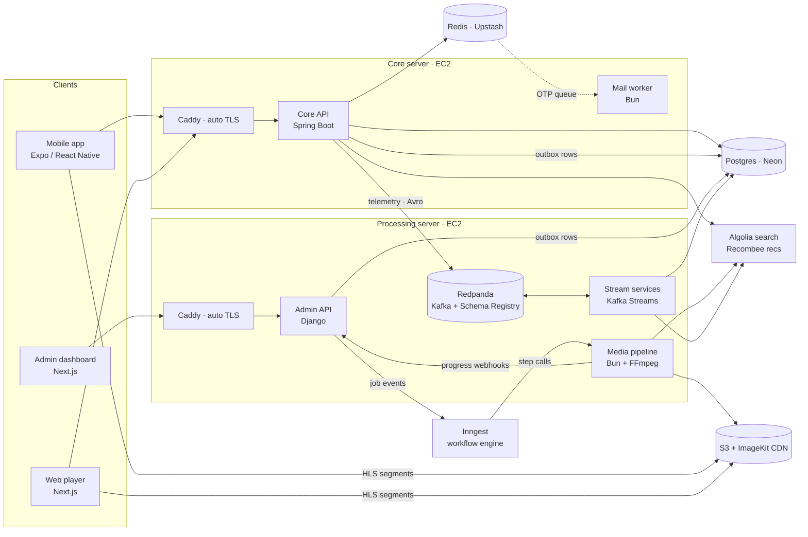
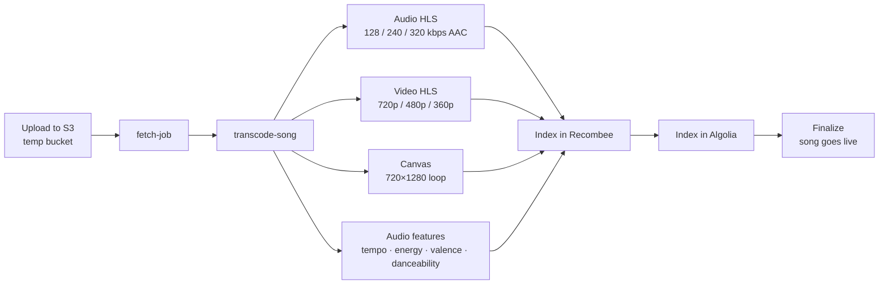

<div align="center">

# 🎵 One Melody

**A full-stack music streaming platform, built end to end by one developer:**
mobile app, web player, admin dashboard, media transcoding pipeline and a real-time
event pipeline, running in production on AWS.

[**Live web player**](https://one-melody.one-org.me) · [Architecture](#-architecture) · [Engineering deep dives](#-engineering-deep-dives) · [Tech stack](#-tech-stack) · [Run it locally](#-run-it-locally)


</div>

---

## 📖 What is One Melody?

One Melody is a Spotify-style music streaming service. Listeners stream songs, watch music
videos, follow artists, build and share playlists, and get recommendations tuned to their
taste and mood. Admins upload new music, which an automated pipeline transcodes, analyses
and publishes within minutes.

I built it to learn how a real streaming product works end to end, not just a single API.
That meant answering questions like these:
- How do you turn one uploaded file into adaptive streams for every connection speed?
- How do you count millions of plays without slowing the app down or double-counting?
- How do you run all of it on a student budget without it falling over?

| | |
|---|---|
| **Built by** | One developer: design, backend, frontend, mobile, DevOps and infrastructure |
| **Codebase** | ~115k lines across Java, Python and TypeScript; 930+ commits |
| **Services** | 6 backend services and 3 client apps, in one monorepo |
| **APIs** | ~95 listener endpoints and 100+ admin routes |
| **Tests** | 500+ automated tests: unit, integration, Kafka topology, Playwright and container tests |
| **Runs on** | 2 AWS EC2 servers (Terraform), Neon Postgres, Upstash Redis, S3 + ImageKit, Vercel |

---


## ✨ Highlights

- **Adaptive streaming pipeline:** every upload becomes HLS audio at 128/240/320 kbps,
  music video up to 720p, and a vertical canvas loop. Encoding uses the GPU or hardware
  encoder when one is available.
- **Event-driven architecture:** Kafka with a transactional outbox, Avro contracts with
  CI-enforced compatibility, and Kafka Streams with exactly-once processing.
- **Recommendations that actually personalise:**
  - Recombee supplies candidates; my own ranking engine re-ranks them using audio features
    (tempo, energy, valence, danceability) and the genres the user picked.
  - Mood radio and cold-start ranking for new users are built on the same features.
- **Cost-aware engineering:** cut background Redis traffic by about 90% (~50k to ~4k
  commands a day). The design lets the serverless Postgres actually sleep, which is what
  decides whether the free tiers last.
- **Production-grade operations:**
  - images promoted to a `:stable` tag, with one-step rollback;
  - OpenTelemetry tracing and alerting;
  - Terraform-managed infrastructure;
  - secrets loaded from AWS Secrets Manager through instance roles.
- **Polished clients:**
  - gapless playback and crossfade;
  - an offline-aware home screen that streams in section by section (Server-Sent Events);
  - telemetry that survives being offline;
  - share links with rich previews.

---

## 🎧 Product tour

### For listeners: mobile app and web player

- **Listen:** adaptive streaming that adjusts to the network, plus gapless playback,
  optional crossfade, synced lyrics and a queue.
- **Pick up anywhere:** playback position syncs, so you can resume on another device.
- **Discover:**
  - search across songs, artists, playlists and even lyric lines;
  - "Made for you" picks, song radio, session radio and **mood radio**.
- **Home that loads instantly:** sections stream in as each one is ready. The last home
  screen is cached, so the app opens instantly even offline.
- **Your library:** favourites, followed artists, listening and search history, and
  personal playlists. Playlists can be private or shared by link, saved by others, or duplicated.
- **Shorts:** a vertical video feed of short clips with their own sound, posted by One
  Melody or by listeners and optionally linked to a song. There's a "For you" ranking,
  likes, sharing and reporting, plus uploads straight from the camera roll.
- **Canvas:** silent looping visuals behind the player and on playlist pages.
- **Onboarding:** pick favourite artists and genres, and recommendations work from the first play.
- **Share:** song links open a public page with artwork and Open Graph previews.

### For the team: admin dashboard

- **Upload and publish:** upload audio, video, cover art and a background loop, then watch each
  processing step live, with timings. Failed jobs can be retried, cancelled or recovered.
- **Shorts moderation:** upload official shorts, hide or delete any short, work through
  listener reports, and ban accounts from posting.
- **Catalog management:** songs, artists, playlists and featured content, with bulk-friendly
  data tables, server-side filters and CSV export.
- **Catalog health:** automatically finds songs missing media, lyrics, audio features or
  search entries, and fixes them in one click.
- **Moderation and access:**
  - block, demote or delete listener accounts;
  - view and revoke sessions;
  - role-based actions, with typed confirmation before anything destructive.
- **Operations view:** platform stats, service health and a live heartbeat from the media pipeline.

---

## 🏗 Architecture



**Why two servers?** Listener traffic is latency-sensitive; transcoding is CPU-heavy. The
core server only serves listeners. The processing server holds the admin API, the media
pipeline, Kafka and the stream services, so a big upload can never slow down someone's
playback. Both sit in one VPC, and Kafka is reachable only over the private network.

**A request, end to end:**
1. Caddy terminates TLS and proxies to the core API.
2. Spring Security validates the JWT: a bearer token for the app, an HttpOnly cookie for the web.
3. The core API answers from the Redis cache where it can, otherwise from Postgres.
4. Media never passes through the API: clients stream HLS straight from the CDN.
5. Listening activity is published to Kafka and processed asynchronously.

| Service | Stack | Role |
|---|---|---|
| **Core API** (`coreEngine/`) | Spring Boot 4.1, Java 21 virtual threads, JPA, Spring Security | Listener API: auth, catalog, playback, home, search, recommendations, telemetry |
| **Admin API** (`adminBackend/`) | Django 6, DRF, Gunicorn | Catalog management, jobs, moderation, pipeline webhooks |
| **Media pipeline** (`audioProcessing/`) | Bun, Inngest, FFmpeg | Validate, transcode, analyse, index and publish uploads |
| **Stream services** (`streams/`) | Spring Boot, Kafka Streams, Spring Kafka | Outbox relay, stats, listening sessions, search/recs sync, email |
| **Mail worker** (`workers/mailEvents/`) | Bun | OTP email through SMTP, SES or Resend, with retries and a dead-letter queue |
| **Event contracts** (`communication/`) | Avro | 17 schemas shared by every JVM service |
| **Web player** (`audioFrontend/`) | Next.js 16, React 19, Tailwind 4 | Browser listening experience |
| **Admin dashboard** (`adminFrontend/`) | Next.js 16, TanStack Query/Table, React Hook Form, Zod | Operations UI |
| **Mobile app** (`audioApp/`) | Expo SDK 58, React Native, expo-audio | iOS and Android app |
| **Schema** (`migration/`) | Flyway | 17 versioned, additive migrations; the single source of truth |

---

## 🔬 Engineering deep dives

These are the problems that took the most thought. Each one shows the problem, the
approach, and why it was built that way.

### 1. Turning one upload into adaptive streams

**Problem:** an admin uploads one large audio or video file. Listeners on 3G and on fibre
both need smooth playback, and a corrupt upload must never reach the catalog.

**Approach:** an [Inngest](https://www.inngest.com/) workflow where each stage is a durable,
retryable step:



- **Fail fast:** every file is checked with `ffprobe` before any expensive work starts.
- **Hardware encoding:** the pipeline detects VideoToolbox, NVENC, Quick Sync or VA-API and
  falls back to `libx264`. The quality ladder never upscales past the source.
- **Durable progress:** each step reports to the admin API through webhooks, so the
  dashboard shows live progress and a crash resumes from the last completed step.
- **Cancellable and tidy:** every step listens for a cancel event, temporary files are
  tracked and cleaned up even on failure, and deletes run as their own step chain across
  Algolia, Recombee, the CDN and S3.

### 2. Counting plays correctly with an event pipeline

**Problem:** every play, skip, search and favourite has to update stats, history,
recommendations and search ranking. Doing all of that inside the request made the API
slow. It also lost work whenever the server restarted, because the in-memory async
listeners died with it.

**Approach:** move side effects onto Kafka (Redpanda), designed so nothing is lost or counted twice.

- **Transactional outbox:** a state change (say, a favourite) and its event are written to
  Postgres in the *same transaction*. A relay publishes them to Kafka. If one happens, so
  does the other.
- **Idempotency everywhere:**
  - every event carries a UUID v7 id;
  - Kafka Streams runs `exactly_once_v2` and drops duplicates for 24 h;
  - history rows are keyed on the event id;
  - stats are written as absolute totals, never `+1`.

  Result: retries and replays are always safe.
- **Contracts as code:** 17 Avro schemas live in one shared module. A CI test enforces the
  same BACKWARD-compatibility rule as Schema Registry, so a breaking change fails before merge.
- **Five stream services in one deployable**, chosen by Spring profile:
  - stats: totals and daily windows;
  - activity: 30-minute listening sessions;
  - sync: batched Recombee and Algolia updates;
  - notification: email with a retry topic and a dead-letter queue;
  - the outbox relay.
- **Resilient by design:**
  - If Kafka goes down, the app keeps telemetry and retries.
  - Favourites still save, and their events publish seconds after Kafka returns (9 s in testing).
  - Login codes fall back to the Redis mail queue after 30 s, so sign-in never waits on Kafka.
- **Safe rollout:** a feature flag (`LEGACY` → `DUAL` → `KAFKA`) lets the new pipeline run
  next to the old one for a week of comparison before cutover, with instant rollback.

### 3. Engineering for cost: a 90% cut in Redis traffic

**Problem:** Upstash Redis used about 500k commands in two weeks, close to the free-tier
limit. Almost none of it was real traffic.

**What I found:** pay-per-command Redis bills even a blocking read that waits and finds
nothing. Background loops were burning ~50k commands a day:
- the mail worker and a cancel worker each polled every 4 s, around the clock;
- a heartbeat ran every 10 s;
- the admin jobs page refreshed every 4 s.

**Fixes:**
- **Mail worker:** one long blocking wait (55 s) instead of polling, shortened only when a
  delayed retry is due.
- **Dead code:** deleted the cancel worker (Inngest already handled cancellation).
- **Heartbeat:** once a minute instead of every 10 s.
- **Admin dashboard:** polling only while the tab is visible, and session renewal at most
  every 10 minutes.
- **Listening progress:** saved every 60 s instead of 20 s.

**Result:** about **50k → 4k commands a day**.

The same thinking applies to **Neon**, the serverless Postgres, which bills compute time
and sleeps after 5 idle minutes:
- the connection pool keeps no idle connections;
- health checks never touch the database;
- the outbox relay is woken by Kafka instead of polling.

### 4. Authentication that's secure and pleasant

- **Passwordless sign-in:** email one-time codes. The flow returns a short-lived temp token.
  - Codes expire in 10 minutes and allow 5 attempts.
  - Resends have a 60 s cooldown.
  - Every auth endpoint is rate-limited per IP.
- **Two client types, one API:** the mobile app uses bearer tokens; the web apps use
  **HttpOnly cookies**, so no token is ever readable by page scripts.
- **Sessions you can see:** each device is a session you can list and revoke. Refresh
  tokens rotate, and logout blacklists the token in Redis.
- **A real bug, found and fixed:** the admin API runs several Gunicorn workers, each with
  its own in-memory cache.
  - A session revoked in one worker stayed valid in the others, and a used OTP could be replayed.
  - Fix: Redis became the single source of truth. A missing key now means revoked, and
    memory is only a fallback when Redis is down.

### 5. A player that feels native

- **Gapless playback and crossfade:** the next track is preloaded and handed over
  precisely. The handover math is pure functions, so it's unit-tested.
- **Offline-first telemetry:** every interaction gets a UUID v7 and is stored on the
  device, then sent in batches of up to 50.
  - Retries are safe because the server drops duplicates.
  - If an older server has no batch endpoint, the app falls back to single calls automatically.
- **Instant home:** the home API streams sections over Server-Sent Events as each one is
  ready. The client persists the last result, so the app opens with content even offline.

### 6. Shipping safely

- **CI tests only what changed:** a path filter detects which services a change touches
  and runs only their test suites.
- **Promoted releases:** images are built per commit, and production runs only a
  **promoted `:stable`** tag. Watchtower deploys it within 30 seconds, and
  `:stable-previous` allows a one-step rollback.
- **Infrastructure as code:** Terraform defines the VPC, EC2, S3, the Kafka storage
  volume, private network rules and Secrets Manager with per-server IAM roles.
- **Observability:** OpenTelemetry traces, metrics and logs from every service, with
  alerts on 5xx rate, p95 latency, failed jobs, the pipeline heartbeat and mail failures.

---

## 🧰 Tech stack

| Layer | Technologies |
|---|---|
| **Backend** | Java 21, Spring Boot 4.1 (Web, Security, Data JPA, Kafka), Python 3.12, Django 6, DRF, Bun, TypeScript, Express |
| **Streaming and events** | Apache Kafka API (Redpanda), Kafka Streams, Avro, Schema Registry, transactional outbox |
| **Media** | FFmpeg, HLS, hardware encoding (VideoToolbox, NVENC, QSV, VA-API), Inngest workflows |
| **Data** | PostgreSQL (Neon), Flyway, Redis (Upstash), Algolia, Recombee |
| **Frontend** | Next.js 16, React 19, Tailwind CSS 4, TanStack Query and Table, React Hook Form, Zod |
| **Mobile** | React Native, Expo SDK 58, expo-audio, AsyncStorage |
| **Infrastructure** | AWS (EC2, S3, VPC, IAM, Secrets Manager, EBS), Terraform, Docker Compose, Caddy, Watchtower, Vercel |
| **Quality and ops** | JUnit 5, Testcontainers, Kafka TopologyTestDriver, Django tests, Bun test, Jest, Playwright, GitHub Actions, OpenTelemetry |

---

## 🧪 Quality

| Area | Tests |
|---|---|
| Core API | ~220 tests: controllers, services, security, caching, event producers, plus a real Kafka container test |
| Stream services | Kafka Streams topology tests, sync mapping, email retries, plus a Postgres + Kafka container test that runs all 17 migrations |
| Event contracts | Schema compatibility against committed snapshots, outbox conversion, UUID v7 ids |
| Admin API | 105 tests: auth and sessions, catalog, jobs, webhooks, outbox |
| Media pipeline | Transcoding, validation, hardware-encoder detection, audio features, the concurrency limiter |
| Mail worker | Queue handling, retries, dead-letter queue, providers |
| Mobile app | 118 tests: queue logic, player math, the offline telemetry queue |
| Admin dashboard | Playwright end-to-end smoke tests |

Before this event pipeline shipped, I also ran it end to end against real Postgres, Redis
and Kafka:
- sign-up with an emailed code;
- batched plays, with a deliberate duplicate dropped;
- stats, history and sessions written correctly;
- a Kafka outage and its recovery.

---

## 🚀 Run it locally

**You'll need:** Java 21, Bun 1.3+, Node 20+, Python 3.12 with [uv](https://docs.astral.sh/uv/),
Docker, FFmpeg, plus a Postgres and a Redis (local or free-tier cloud).

```bash
# 1. Configure: copy each service's .env.example to .env and fill it in

# 2. Create the database schema
cd migration && ../mvnw spring-boot:run && cd ..

# 3. Start local infrastructure
docker compose up -d inngest                    # workflow engine,  http://localhost:8288
docker compose up -d redpanda redpanda-init     # Kafka (optional), localhost:19092

# 4. Start the services (one terminal each)
./mvnw -pl coreEngine -am spring-boot:run                    # core API        :8080
./mvnw -pl streams -am spring-boot:run                       # stream services
cd adminBackend/admin && uv run python manage.py runserver   # admin API       :8000
cd audioProcessing && bun install && bun run dev             # media pipeline  :5010
cd audioFrontend && bun install && bun run dev               # web player      :3000
cd adminFrontend && bun install && bun run dev -- -p 3001    # admin dashboard :3001
cd audioApp && npm install && npx expo start                 # mobile app
```

```bash
# Tests
./mvnw -pl coreEngine -am test                   # core API (Docker tests skip without Docker)
./mvnw -pl streams -am test                      # stream services
cd adminBackend/admin && uv run python manage.py test
cd audioApp && npm test
cd adminFrontend && bun run test:e2e
```

> The Java modules build from the repo root, because they share the Avro contracts in
> `communication/`.

---

## 📂 Repository layout

```
coreEngine/          Core API (Spring Boot)
communication/       Shared Avro event contracts
streams/             Outbox relay + Kafka Streams services
adminBackend/        Admin API (Django)
audioProcessing/     Media pipeline (Bun + FFmpeg + Inngest)
workers/mailEvents/  Mail worker (Bun)
audioFrontend/       Web player (Next.js)
adminFrontend/       Admin dashboard (Next.js)
audioApp/            Mobile app (Expo / React Native)
migration/           Flyway migrations
Docker/              Production compose files, deploy scripts, release guide
infra/               Terraform, Kafka topics and runbook, alerts, secrets guide
assets/              Architecture diagram
```

### Deeper documentation

| Topic | Document |
|---|---|
| Event pipeline: modes, rollout, rollback | [`infra/kafka/README.md`](infra/kafka/README.md) |
| Secrets Manager setup and key rotation | [`infra/SECRETS.md`](infra/SECRETS.md) |
| Terraform environments and modules | [`infra/README.md`](infra/README.md) |
| Alerts and the signals behind them | [`infra/observability/README.md`](infra/observability/README.md) |
| Image tags, promotion and rollback | [`Docker/RELEASES.md`](Docker/RELEASES.md) |
| Architecture diagram | [`assets/architecture_diagram.svg`](assets/architecture_diagram.svg) |

---

## 📚 What I learned

- **Distributed systems are about failure, not the happy path.** Most of the event
  pipeline's code exists for duplicates, outages, retries and replays. The hard question
  is always "what happens if this crashes halfway?"
- **Cost is an engineering constraint.** On pay-per-request and serverless infrastructure,
  a harmless-looking polling loop can use up a month's quota in two weeks. Every background
  loop now gets a "what does this cost per day?" check.
- **Make change safe before making it big.** Feature flags, a dual-run mode, promoted
  releases and backward-compatible schemas let large changes ship without big-bang risk.
- **Tests that use real infrastructure catch real bugs.** Container tests against Kafka and
  Postgres, plus a full end-to-end run, found problems unit tests never would. Examples: a
  producer blocking a request thread on a cold start, and events waiting too long after an outage.
- **Product thinking matters as much as code.** An instant home screen, gapless playback
  and share previews are small to build but decide how the product *feels*.

## 🗺 Roadmap

- [ ] Cut over to the Kafka pipeline fully (`DUAL` → `KAFKA`), then retire the legacy paths
- [ ] SASL authentication on Kafka, and a managed multi-broker cluster
- [ ] A staging environment, with migrations run automatically in the deploy pipeline
- [ ] Analytics pages in the admin dashboard, built on the new stats tables
- [ ] Usage alerts for the database and Redis quotas
- [ ] Offline downloads in the mobile app

---

<div align="center">

**Built by Karan Kumar**, B.Tech Electronics & Communication Engineering, NIT Silchar

[GitHub](https://github.com/karankumar786786) · [LinkedIn](https://www.linkedin.com/in/karan-saw-75a3b8391/) · LeetCode 500+ problems

*If this project interests you, I'd love to talk about it.*

</div>
